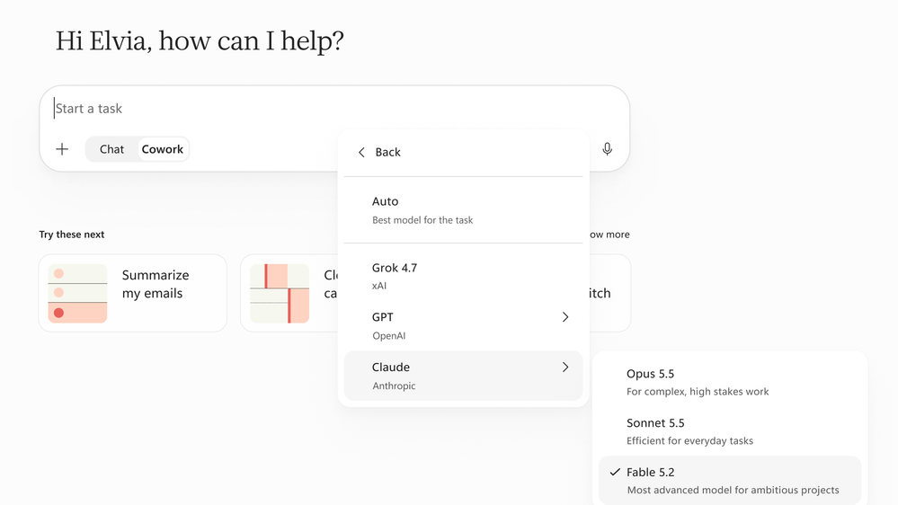

※ この記事は、[Available today: Anthropic Claude Fable 5.2 in Microsoft Copilot](https://techcommunity.microsoft.com/blog/microsoft-copilot-blog/available-today-anthropic-claude-fable-5-2-in-microsoft-copilot/4571829) の抄訳です。最新の情報はリンク先をご確認ください。この記事は Microsoft 365 Copilot および GitHub Copilot を使用して抄訳版の作成が行われています。

Anthropic の Fable モデルの最新版である Claude Fable 5.2 が、Copilot Cowork (Cowork) と Copilot Studio で展開され始めています。Copilot で選べる最先端モデルの幅が広がり、より複雑なタスクを AI に任せる際に、チームで業務に合ったモデルを選べるようになります。

モデルがどれだけ役立つかは、扱うコンテキスト次第です。Copilot では、Work IQ が、既存のアクセス許可の範囲内で、組織のファイル、会議、チャット、業務データを Fable 5.2 の回答の根拠として活用します。そのため、回答にはプロンプトだけでなく、実際の業務が反映されます。これにより、回答の精度が高まり、より信頼しやすくなります。

## 今日から使い始める

Fable 5.2 は、Copilot Cowork と Copilot Studio の対象となる利用者に向けて、展開され始めています。

管理者は引き続き制御できます。Microsoft 365 管理センターで[アクセスを管理](https://learn.microsoft.com/microsoft-365/copilot/connect-to-ai-subprocessor)し、組織で利用できるかどうかを設定できます。提供状況は、地域や組織によって異なる場合があります。

展開状況は、[AI at Work Roadmap](https://www.microsoft.com/microsoft-365/roadmap) と [Microsoft 365 Copilot のリリース ノート](https://learn.microsoft.com/microsoft-365/copilot/release-notes?tabs=all)で確認できます。

モデル自体の詳細は、[Anthropic による Claude Fable 5.2 の発表](https://www.anthropic.com/claude-fable-and-mythos-5-2)をご覧ください。
