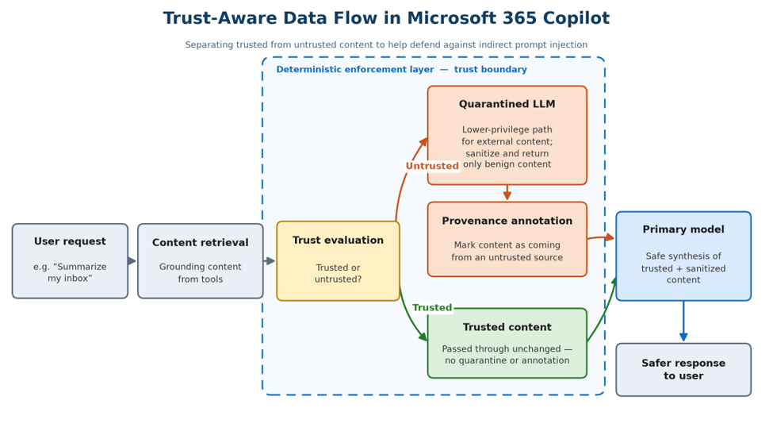

※ この記事は、[Building Trust-Aware Controls for AI: Differentiated handling of untrusted content](https://techcommunity.microsoft.com/blog/microsoft-copilot-blog/building-trust-aware-controls-for-ai-differentiated-handling-of-untrusted-conten/4562160) の抄訳です。最新の情報はリンク先をご確認ください。この記事は Microsoft 365 Copilot および GitHub Copilot を使用して抄訳版の作成が行われています。

組織が日常のワークフローに生成 AI を取り入れるにつれ、従来のアクセス制御、ID、データ保護のモデルでは捉えきれない、新たな種類のセキュリティ課題に直面しています。特に重要なのが、間接的なプロンプト インジェクションです。これは、AI システムがタスクの一環として処理する可能性のあるメール、文書、メッセージなど、一見正当なコンテンツに悪意のある指示が埋め込まれるものです。

こうしたコンテンツが信頼できるプロンプトとともにモデルに渡されると、システムは埋め込まれた指示を、データではなく命令として扱う可能性があります。その結果、モデルの動作が影響を受け、意図しないデータの開示、応答への不正確な情報の混入、その他の被害につながる可能性があります。

これらの攻撃は、既存のアクセス許可の範囲内だけで発生することがあります。システムにはコンテンツへのアクセスが許可されており、認証、アクセス ガバナンス、データ損失防止といった従来の制御が設計どおりに機能していても、推論時のリスクは対処されないまま残る可能性があります。

### AI システムの構造的な隔たり

従来のコンピューティング システムは、ハードウェアによる分離、特権命令セット、アクセス制御モデルなど、構造的な制御を階層的に適用し、特定の種類の攻撃経路にさらされるリスクを低減しています。

多くの生成 AI アーキテクチャでは、指示とデータが、単一の入力ストリーム内のトークンとして表現されます。従来のコンピューティング システムとは異なり、ニューラル ネットワークは、それ自体で指示とデータを同等に構造的に分離する仕組みを備えていません。このアーキテクチャの違いによって、セキュリティ モデルは根本的に変わります。根拠として使われる信頼できないコンテンツに埋め込まれた悪意のある指示も、元の指示とともに処理されるためです。

業界のガイダンスにも、この問題の深刻さが表れています。[OWASP Top 10 for LLM Applications 2026](https://genai.owasp.org/resource/owasp-genai-llm-top-10-2026/) は、プロンプト インジェクションを LLM アプリケーションのアプリケーション レベルのセキュリティ リスクの第 1 位に挙げています。分類器に基づくフィルタリング、入力のサニタイズ、システム プロンプトの堅牢化といった既存の対策は、間接的なプロンプト インジェクションにさらされるリスクを低減できます。しかし、プロンプト インジェクションに関するセキュリティ上の脆弱性の多くは、個別の修正では対処が難しく、攻撃パターンの変化によって再び問題が生じる可能性があるため、継続的なセキュリティ リスクとなります。これらの手法はリスクを低減しますが、単一の対策で間接的なプロンプト インジェクションの試みをすべて防ぐことはできません。新しいアプローチでは、多層防御戦略の一環として推論時に決定論的な強制適用レイヤーを追加し、これらの対策を補完します。

### 新たな方向性: 信頼境界を考慮した決定論的な制御

近年の研究では、コンテンツの出所に応じて、あらかじめ定義した制約を適用するアーキテクチャ上のアプローチが検討されています。これらのアプローチは、確率的な検出だけに頼るのではなく、明確な信頼境界を維持する決定論的な制御を導入します。[研究論文はこちら](https://arxiv.org/pdf/2505.23643)。

このアプローチは、Microsoft 365 Copilot で取得したコンテンツ (ツールの出力) と主要な大規模言語モデルの間に、決定論的な強制適用レイヤーを導入するよう設計されています。このレイヤーは、信頼できない出所からのコンテンツがモデルのコンテキストに入る前に、特別に処理するための信頼境界を設けます。

### 信頼境界を考慮した処理の仕組み

#### 信頼レベルに応じたコンテンツの処理

Microsoft 365 Copilot が応答の根拠となるデータを取得すると、システムは決定論的なシグナルを使って、コンテンツを信頼できるものと信頼できないものに分類します。

たとえば、組織外からのメールなどの外部コンテンツは、組織の信頼境界を越える際に、ポリシーによって信頼できないものに分類できます。この分類は、プロンプト インジェクションのリスク低減に役立つ、実用的で拡張性のあるシグナルとなります。

#### 隔離と制約付き処理による権限の分離

信頼できないコンテンツは、主要なモデルに直接渡されるのではなく、隔離され、機能が制限された処理経路に送られます。そこで、ユーザーの質問のコンテキストに基づいて処理され、変換された表現になります。この変換では、有用な情報を保持しながら悪意のあるコンテンツを取り除くことを目指します。主要なモデルに提示できる情報を制限することで、攻撃対象領域を縮小します。

これにより、攻撃者の指示が作用できる領域を減らし、後続の推論に持ち込める情報を制限します。

#### 出所を考慮した処理

システムは、コンテンツが信頼できない出所に由来する場合、そのことを示す明示的な出所マーカーを追加できます。出所の情報を保持することで、後続の処理でコンテンツの由来を考慮でき、入力の信頼特性を応答に反映しやすくなります。

#### より安全な情報の統合

主要なモデルは、次の情報を使って応答を生成します。

- 信頼できるコンテンツ (変更せずにそのまま渡される)
- 信頼できないコンテンツを変換・構造化した表現

これにより、主要なモデルが信頼できない入力にさらされる機会を減らし、攻撃者の指示が結果に影響を及ぼす可能性を低減します。同時に、タスクに関連する情報を保持し、有用性を維持します。

#### 例: メールを介したプロンプト インジェクション

隠された指示や埋め込まれた指示を含む、日常的な業務メールを考えてみます。ユーザーが AI アシスタントに受信トレイの要約を依頼すると、システムはそのメールを取得し、内容をシステム プロンプトとともにモデルに渡します。その結果、埋め込まれた悪意のある指示が、モデルの出力に影響を与える可能性があります。

このような場合、アクセス ポリシーへの違反やデータの不適切な取り扱いが起きているわけではありません。システムは設計どおりに動作していますが、推論時に、要約対象のデータと実行すべき指示を区別できないことがあります。

### 決定論的な制御が間接的なプロンプト インジェクションのリスク低減に役立つ仕組み

このアーキテクチャは、オーケストレーション パイプライン内の定められた箇所で、一貫した制御を適用します。従来のアプローチは、共通の入力空間の中で悪意のある動作を特定しようとするのに対し、このアプローチは、その空間を情報がどのように流れるかを制限します。

強制適用レイヤーは、次の機能を提供します。

- **決定論的なシグナル**: オーケストレーション パイプライン内の決まった箇所で、決定論的なシグナルを使い、信頼できないコンテンツを捕捉します。
- **構造化された受け渡し**: 信頼できないコンテンツを変換し、ユーザーのプロンプトに基づいて、無害なコンテンツを保持しながら悪意のあるコンテンツを取り除きます。

信頼できない入力の再現度と、動作に影響を及ぼせる範囲の両方を低減することで、元のデータへのアクセスがシステムに許可されている場合でも、間接的なプロンプト インジェクション攻撃が成功する確率を下げます。

### 今後の展望

Microsoft 365 Copilot は、新しい強制適用レイヤーを導入しつつあります。初期の取り組みでは、外部との通信を含む、リスクの高いコンテンツに重点を置いています。さらに細かな信頼モデルに対応するため、対象とするコンテンツの種類や出所の拡大に加え、企業のシグナルやポリシー システムとのより深い統合も検討しています。

テナントでこの保護を構成するには、信頼できないコンテンツの識別に使用する、該当する Outlook の送信者設定を有効にし、[CVE-2026-55145 の構成ガイダンス](https://msrc.microsoft.com/update-guide/vulnerability/CVE-2026-55145)を確認してください。利用可否や動作は、リリース状況やテナント環境によって異なる場合があります。

間接的なプロンプト インジェクション攻撃の増加は、AI セキュリティにおける、より広い変化を浮き彫りにしています。この取り組みは、明示的な信頼境界、制約付き処理、決定論的な強制適用という基本的なセキュリティ原則を、AI の推論レイヤーに取り込むものです。

生成 AI が進化し続ける中で、こうしたアーキテクチャの進歩は、企業向け AI システムの安全性、信頼性、信頼できる仕組みを、設計段階から高める助けとなります。
