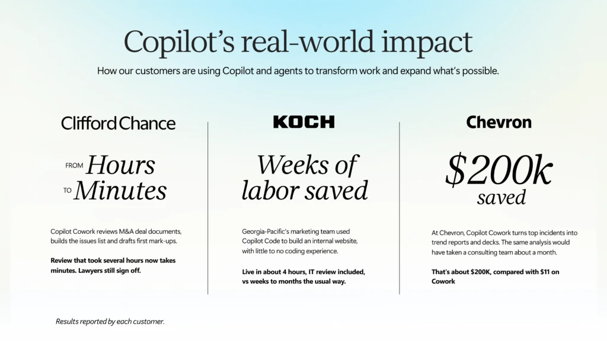

※ この記事は、[Copilot at Microsoft Ignite: Expanding what’s possible with intelligence built for work](https://www.microsoft.com/en-us/copilot/blog/2026/11/17/copilot-at-microsoft-ignite-expanding-whats-possible-with-intelligence-built-for-work/) の抄訳です。最新の情報はリンク先をご確認ください。この記事は Microsoft 365 Copilot および GitHub Copilot を使用して抄訳版の作成が行われています。

本日朝の Microsoft Ignite 2026 では、Copilot のビジョンが、お客様にとって現実になりつつあることを紹介しました。**Home** では **Microsoft 365 Copilot Chat (Copilot Chat)** と **Copilot Cowork (Cowork)** がまとまり、**Office in Copilot** とともに一般提供を開始しています。**Copilot Code** は数週間以内に一般提供となる予定です。アプリを安全にホスト・管理する **Copilot Managed Runtime** は一般提供となり、**Autopilot** は本日から Frontier のお客様への展開を開始します。営業、サービス、財務、法務のチーム向けに開発した新しいプラグインとスキルも利用できます。さらに **Agent 365** プラットフォームを拡張し、AI への投資について、より詳しく把握できるようにします。

Copilot は、AI の能力を実際の人々の実際の仕事に役立てることを目指して開発しています。すべてにおいて最も優れた研究機関はありません。利用者が 1 つだけを選ぶ必要もありません。Copilot は、業界をリードする複数のモデルを組み合わせます。**Auto** routing を使えば、従業員が仕事ごとに適切なモデルを選ぶ必要はありません。Auto は裏側で、タスクに合ったモデルと処理のレベルを動的に選び、品質、速度、コストのバランスを取ります。より多くの処理能力が必要な場面には資源を振り向け、そうでないタスクでは使用量を抑えます。従業員は OpenAI または Anthropic のモデルを手動で選ぶこともできます。モデルへのアクセスは、組織のポリシーに従って管理されます。

Copilot の強みは **[Work IQ](https://www.microsoft.com/en-us/copilot/features/work-iq)** にもあります。ナレッジ ワークは、メール、Teams の会議やチャット、Word のメモ、PowerPoint のスライド コメントなどに分散していて、複雑です。Microsoft 365 には 19.5 エクサバイトを超えるデータがあり、毎週、900 億通のメール、150 億件の Teams メッセージ、100 億件の新しいファイルが追加されています。モデルにその情報へのアクセスを許可するだけでは十分ではありません。タスクに必要な情報を見極め、推論することが課題です。[Work IQ はこの課題を解決します](https://aka.ms/WorkIQIgnite2026)。利用者が探していることを理解し、無視できる情報を特定します。その結果、従来の API では実現できない、正確で効率的な回答を得られます。

## 仕事を支える新しい基盤

仕事は、1 種類の作業だけで成り立つわけではありません。質問し、作業を委任し、ものを作り、完了するまでフォローします。長年、これらの作業にはそれぞれ別のツールが使われ、すべてをつないでいたのは利用者でした。そこで、すべてを 1 か所で行えるようにしました。

一般提供を開始した [**Home**](/blog/home-your-starting-place-for-work-in-the-microsoft-copilot-app/) は、Copilot を使い始める場所です。**Copilot Chat** と **Cowork** がここにまとまります。会議、チャット、文書、メール、アプリ、エージェントをまたいで仕事を進めるときも、Home がコンテキストを保ち、作業を前に進めます。最近のアクティビティを確認し、Copilot が支援できることの提案を受け取り、中断したところから作業を再開できます。Copilot Chat で簡単な質問をしたり、Cowork にワークフロー全体を委任したりできます。

Copilot は、利用者の作業を増やさずに、より多くのことを実現します。Home には **Auto** を使う 1 つの入力欄があり、ここからあらゆる仕事を始められます。達成したいことを Copilot に伝えると、タスクに適したモデルと処理のレベルに合わせて、仕事を自動的に振り分けます。複雑な作業では、Auto が Copilot Chat から Cowork への切り替えを提案することがあります。提案に同意すると、Copilot がタスクをスムーズに引き継ぎ、適切なリソースで成果につなげます。

Home には **Today** という新しいエクスペリエンスもあります。メール、予定表、Teams のスレッド、会議、タスクをまとめて確認できるコマンド センターです。見逃したこと、今すぐ対応が必要なこと、後回しにできることを先回りして表示します。Today は仕事を見せるだけでなく、完了まで支援します。下書きは編集できる状態で用意され、予定の変更はすでに提案され、忘れていたフォローアップも、状況をすばやく把握できるコンテキストとともに送信を待っています。Today は現在、Copilot アプリと Outlook でプライベート プレビューとして提供されています。

AI 企業が独自の文書、スライド、スプレッドシートを作る動きが広がっています。これは、ナレッジ ワークが Word、Excel、PowerPoint を基盤としているという、以前からわかっていたことを示しています。Copilot は Office アプリで長年利用され、機能も大きく向上してきました。今回、**Office** の機能を Copilot アプリに直接取り込みます。アイデアから完成した文書へと進み、チームメンバーと編集・共同編集できます。ファイルには最初から Microsoft 365 のアクセス許可、秘密度ラベル、コンプライアンス制御が引き継がれるため、共同作業中も保護されます。Copilot は、利用量に応じた課金を気にせず PowerPoint のプレゼンテーションや Excel のスプレッドシートを作成できる唯一の AI ツールです。これらの機能は Copilot のサブスクリプション ライセンスに含まれています。

Copilot の機能を **[Autopilot](https://www.microsoft.com/en-us/copilot/features/autopilot)** で拡張します。Autopilot は利用者一人ひとりに合わせて動作し、常に利用できる、自律型の信頼できるエージェントです。利用者のテナント内にあり、独自の ID、メモリ、ツールを持ちます。Teams、Outlook、チャット、チャネル、文書など、人々が普段使う場所に表示されるため、同僚のように `@mention` で呼び出せます。Teams チャネルの確認、メールのフォローアップ、定期的な作業の実行、プロジェクト管理を、プロンプトを待たずに進められます。たとえば、サプライヤーのレビュー プロセス全体を設定・管理できます。スケジュールと逆算した作業計画を作成し、準備、会議、フォローアップを自律的に進め、関係者に状況の更新を依頼することもできます。

自律的に動くエージェントに実際の仕事を任せるには、信頼が欠かせません。そのため、Autopilot は IT 部門がすでに利用している ID、セキュリティ、コンプライアンスの基盤上で動作します。それぞれの Autopilot には独自の Microsoft Entra Agent ID と担当マネージャーが設定されます。IT 部門はアクセス範囲を設定し、いつでもアクセスをブロックできます。サインインと操作は Autopilot 自身の名前で記録されるため、セキュリティ チームは明確な監査証跡を確認できます。Work IQ を基盤とする Autopilot は、既存のアクセス許可の範囲内で組織の働き方を理解します。Autopilot に任せる仕事は利用者が決められ、重要な操作の前に確認を求めることもできます。Autopilot は本日から Frontier のお客様への展開を開始します。

仕事の未来は、人とエージェントの共同作業です。これまで AI とのやり取りは、ほとんどが 1 人で行うものでした。**Workspaces** は、共有コンテキストを基に、人とエージェントが共通の目標に向けて進む、複数の参加者による協働型の体験を実現します。Copilot Notebooks の進化形として、人とエージェントが互いの仕事を基に作業を進めます。エージェントが文書の一部を下書きし、利用者が確認します。利用者がコメントを残すと、エージェントがそれを引き継ぎます。Autopilot にタスクを任せると、最終決定の前に利用者へ確認します。ファイル、会話、人、エージェントに簡単にアクセスできる Copilot アプリ内で使えます。Microsoft Teams での共同作業も続けられます。Workspaces は Frontier で利用可能になりました。

アプリは、ナレッジ ワーカーが生み出す新しい成果物です。数週間以内に一般提供となる **[Copilot Code](https://www.microsoft.com/en-us/copilot/features/code)** を使うと、問題を最もよく理解する人が、その解決策を作成できます。アプリ、対話型ダッシュボード、常時表示できるデスクトップ ウィジェットなど、作りたいものを自分の言葉で説明します。Copilot が最適な方法を選び、作成します。Word 文書と同じように共有できます。アプリはテナント内の **[Copilot Managed Runtime](https://www.microsoft.com/en-us/copilot/products/copilot-managed-runtime)** で安全にホスト・管理されます。この機能は本日から一般提供されています。すべてのアプリは Microsoft 365 管理センターで確認・管理できるため、IT 部門が制御を維持できます。

これが新しい Copilot です。仕事のあらゆる方法を 1 か所にまとめます。**Windows** ではさらに強力になります。Hybrid Intelligence により、ローカル PC 上のあらゆるコンテキストに基づいて回答し、ローカルの操作を実行できます。適切な作業を PC 上で動作するモデルに任せることもでき、時間とコストを節約できます。

ただし、ビジネスの中で実際の価値を生み出すまでは、どの機能も意味を持ちません。現在、Fortune 500 企業の約 80% が Cowork を利用しています。

製薬会社の Lilly では、チームが複数ステップの調査・分析に Copilot を使い、画期的な成果への道のりを短縮しています。Lilly のチームは、現在は治療できない病気を将来治療可能にするため、何十年にもわたり科学の進歩に取り組んできました。Lilly では 5,000 人を超える人々が毎月 [Copilot Cowork](http://aka.ms/cowork-ignite2026) を利用しています。科学者のチームも、実験を始める前に有望な方法を見つけるため、複数の手順を伴う調査タスクを Cowork に任せています。この共同作業によって、Lilly の科学者は、誰かの次の治療薬につながるかもしれない研究に、より多くの時間を使えるようになりました。

Bayer、Honda、Mastercard、Michelin も、Copilot を活用して仕事の進め方を変えています。

## ビジネスの進め方を再設計する

Copilot は拡張可能なプラットフォームです。Work IQ がコンテキストを提供し、Microsoft とパートナーが開発したプラグインが、組織固有の知識、ビジネス データ、プロセスを Copilot のエクスペリエンスに取り込みます。[新しいプラグイン カタログ](https://aka.ms/plugins)でプラグインを簡単に見つけられます。また、[統合プラグイン レジストリ](https://techcommunity.microsoft.com/blog/microsoft-copilot-blog/introducing-the-plugin-registry---one-place-to-discover-and-govern-plugins-for-m/4559682)で一元管理し、制御できます。

本日、更新された Dynamics 365 Sales、Dynamics 365 Customer Service、Dynamics 365 Finance and Operations のプラグインを備えた **[Dynamics 365 in Copilot](https://aka.ms/D365Ignite2026)** を発表します。これらのプラグインは、100 種類を超える構築済みスキルを Copilot に取り込みます。アカウント計画の作成、PowerPoint での営業プレゼンテーションの作成、顧客との会議の準備、営業パイプラインの優先順位付け、サプライヤー管理、アカウントの照合などを、仕事の流れの中で行えます。エージェント型の記録システムである Dynamics 365 は、Work IQ と [Agent 365](https://www.microsoft.com/en-us/microsoft-agent-365) に統合されています。

[営業](https://aka.ms/copilotsolutions-sales)では、Copilot が CRM と連携して営業パイプラインの優先順位付け、予測の集計、案件を進める準備の確認、競争戦略の策定、営業担当者の会議準備を支援します。フォローアップや CRM の更新内容も、確認できる下書きとして作成されます。丁寧に設計された 44 種類の営業スキルを使うと、エージェントが見込み顧客の評価、見込み顧客の調査、アウトリーチの管理など、繰り返し行う作業をさらに進められます。営業担当者は、必要な調査が済んだ有望な案件を引き継ぎ、顧客との時間を増やせます。

[顧客サービス](https://aka.ms/copilotsolutions-service)では、13 種類のスキルを使い、ケース管理システムと連携して、ケースの振り分け、履歴の整理、ナレッジの調査、顧客への返信の下書き、エスカレーションの概要作成を行えます。ケースの更新は、確定する前に確認できるよう保留されます。エージェントはさらに、ケースの作成・更新、フォローアップと終了、解決済みケースのナレッジ化、やり取りの品質評価も行います。

営業と顧客サービスでは、あらゆる記録システムへの接続が重要です。そこで、新しいプラグイン **[Salesforce in Copilot](https://aka.ms/AA1457n5)** を発表します。38 種類を超える構築済みの営業スキルを備え、Salesforce のコンテキストを、人々がすでに仕事で使っているシステムに取り込みます。Copilot は、アカウント、案件、営業パイプラインのデータを、会話、約束事項、意思決定と組み合わせます。対話型ウィジェットを使うことで、情報を取得するだけでなく、ビジネスを理解しやすくします。

[財務](https://aka.ms/copilotsolutions-finance)では、Copilot アプリ内で、より広範なワークフローを直接進められます。Excel と ERP プラットフォームの機能を活用し、30 種類の構築済み財務スキルを使えます。Copilot Chat からブックを分析、編集、共同編集したり、Excel モデルと分析を投資委員会向けのメモなどの成果物にまとめる複数ステップの作業を Cowork に委任したりできます。月次決算から買収評価まで、Copilot は財務チームの実際の仕事を支援します。

[法務](https://aka.ms/copilotsolutions-legal)では、20 種類を超える専用スキルを使って、契約書の作成と交渉、義務や期限の管理、調査結果に基づくガイダンスの作成、業務で使っているシステム内での法的案件の進行を支援します。Copilot は、法務エンジニアと実際の法務ワークフローを基に開発した、Word と Cowork の法務スキルをまとめます。また、信頼できる法務システムに接続するパートナー製プラグインも提供します。法務担当者は、既存のセキュリティ、コンプライアンス、ガバナンスの制御により保護された環境で、主導権を維持できます。

BNY の Commercial Hub 共同リーダーであるマネージング ディレクターの Christian Lewis 氏は、次のように述べています。「アカウントの分析情報、サービスの更新、重要な顧客の動向をリアルタイムで示すことで、チームは連携を保ち、情報に基づいた判断を下し、アプリを切り替えずに行動できます。このつながったエクスペリエンスにより、組織は顧客に関する共通のコンテキストを基に仕事を進め、生産性を高め、顧客への価値提供に集中できます。」

## 安心して規模を拡大する

すべての IT リーダーに、管理、ガバナンス、セキュリティを通じた制御が必要です。すべてのビジネス リーダーには、ビジネス価値を理解し、支出を管理する方法が必要です。Copilot には、自信を持って規模を拡大するために必要な機能を備えています。

本日、**Agent 365** を拡張し、環境全体をさらに制御できるようにします。Anthropic、Databricks、OpenAI、Salesforce などのプラットフォームとの新しい接続を通じて可視性を広げ、複数のテナントにまたがるエージェントの管理も支援します。また、Entra Agent ID による ID とアクセスのガバナンスを拡張します。Model Context Protocol (MCP) サーバー、プラグイン、スキルなど、エージェント ツールの新しい制御を追加します。さらに、Intune、Defender、Windows と Microsoft Execution Containers (MXC) の連携を深め、デバイス上で動作するローカル エージェントのセキュリティと封じ込めを強化します。

Agent 365 は AI の FinOps を通じて、ビジネス価値の把握にも対応します。組織は AI の支出を管理・制御するだけでなく、その投資が生み出す価値も理解できます。AI 支出の増加に伴い、これはさらに重要になります。企業の AI 支出は 1 年で 2 倍になり、その 80% 超が企業の IT 予算の外で発生しています。1 そのため、IT リーダーには管理、ガバナンス、セキュリティによる制御が、ビジネス リーダーには支出、導入、価値の可視化が必要です。

この課題に対応するため、新しいエクスペリエンス **[Agent 365 Business Analytics](https://aka.ms/a365businessanalytics/blog)** を発表します。支出、ガードレール、導入状況、投資収益率 (ROI) を結び付けます。Frontier Public で本日から展開を開始し、トークン数ではなく、完了した仕事を基準に投資を測定する新しい方法を提供します。タスク、その仕事を人が行う場合にかかる時間、Cowork が担った割合を分析します。これにより、AI が支援した時間と、その仕事の価値を詳しく把握できます。こうした分析情報を使い、リーダーは支出を理解して制御し、AI が生み出すビジネス価値を把握し、次の投資先についてより良い判断を下せます。

さらに **Agent 365 Cost Management** により、IT 部門はユーザー、サービス、エージェント、モデルごとの消費量を追跡し、支出の要因を一元的に確認・制御できます。リーダーは支出ポリシー、上限、先回りしたアラートを設定し、利用可能なモデルを制御できます。Cowork では、チームが支出の上限を設定できるため、予想外に支出が膨らんだり、請求時に驚いたりすることはありません。

また、AI 支出を 2 つの方法で制御できるよう、**料金モデル**も独自に設計しました。1 つ目は、予測しやすいユーザー単位のサブスクリプションで、強力な Copilot 機能を広く利用できるようにします。2 つ目は従量課金モデルで、特に難しいタスク向けに最も高性能な AI を利用できます。両方を組み合わせることで、すべての人に適切な AI を提供しながら、高度な AI を必要とする利用者も支援できます。Frontier が進展するにつれて、さらに多くの機能をサブスクリプション ライセンスに移していきます。ユーザー サブスクリプション ライセンスに Auto と Work IQ の機能を組み合わせることで、Copilot は他の AI ツールより低コストで効率的になります。GigaOm の最近のレポートによると、同等の品質で、日常的な利用者の場合、[Copilot は Claude より 84%、ChatGPT より 63% 低コスト](https://www.microsoft.com/en-us/copilot/blog/2026/11/16/what-ai-at-work-really-costs/)です。高度な利用者の場合は、Claude より 68%、ChatGPT より 35% 低コストです。

最も重要なのは、どの企業が最も強力な AI を持っているかだけではありません。その技術を実用的で経済的な形にし、実際のビジネス成果につなげられるのは誰かということです。Copilot は、すべてのお客様がそれを実現できるよう支援します。

## 利用を始める

本日は、[Copilot](https://www.microsoft.com/en-us/copilot) のビジョンが、お客様にとって現実になりつつあることを紹介しました。1 か所で、質問し、作業を委任し、作成し、自動化できます。Teams では、人とエージェントが一緒に仕事を進めます。財務部門では、AI ができることを基に業務を再設計できます。組織が AI 支出を理解・管理するためのツールも利用できます。

企業を動かすのは、人々のアイデア、判断力、専門知識です。Copilot と Windows は、人々ができることを広げ、組織が新しい可能性を繰り返し生み出せる価値に変えるのを支援します。すべての従業員が AI を活用し、より多くの成果を上げながら、ビジネスを加速できるよう支援していきます。利用者の皆さまやチームが、こうした新しい力でどのような成果を生み出すのか、楽しみにしています。

1 Boston Consulting Group, “The Formula for Agentic AI Value: The Applied AI Index 2026,” 2026 年 9 月 30 日。[レポート](https://www.bcg.com/publications/2026/the-formula-for-agentic-ai-value)
