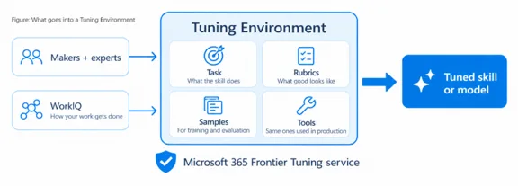

※ この記事は、[Frontier Tuning opens to more customers, with new tools for your teams](https://devblogs.microsoft.com/microsoft365dev/frontier-tuning-opens-to-more-customers-with-new-tools-for-your-teams/) の抄訳です。最新の情報はリンク先をご確認ください。この記事は Microsoft 365 Copilot および GitHub Copilot を使用して抄訳版の作成が行われています。

6 月の Microsoft Build で Frontier Tuning を発表し、対象を絞ったお客様向けにプライベート プレビューを開始しました。お客様自身の専門知識を評価基準として、AI がそれぞれのビジネスに合った働き方をできるようにすることが目的です。

その後、プライベート プレビューに参加したお客様は、ビジネスにとって重要な業務向けにチューニングしたエージェントを作成・テストしてきました。製品も、お客様とともに進化しています。本日の Microsoft Ignite では、3 つの更新を発表します。チーム自身がチューニングできる新しいツール、EY が Frontier Tuning を活用する事例、そして、より多くの組織が利用を始められるよう拡大するプライベート プレビューです。

※ 訳者注: 翻訳元の記事では、本文冒頭に「Sign up for the private preview」というボタンが表示されています。

### **Frontier Tuning のプライベート プレビューを拡大し、チューニングを作成者や専門家の手に届けます。**

プライベート プレビューの開始時、お客様は Microsoft の Forward Deployed Engineers と協力して、シナリオの定義、評価基準の設定、チューニングの実行を行いました。そこで得た知見を基に、プレビュー参加者が本日から利用できるツールを開発しました。

- **GitHub Copilot 用 Frontier Tuning プラグイン**を使うと、作成者と専門家が、Work IQ を通じて業務の進め方を取り込みながら、チューニング環境 (Tuning Environment) を共同で構築できます。
- **Frontier Tuning CLI と API** を使うと、開発者は普段使っているツールからチューニングを実行し、チューニングしたスキルを独自のエージェントに組み込めます。
- **プラグインとして Copilot Cowork (Cowork) に公開**すると、作成者の承認後、専門家の判断を利用者が活用できるようになります。利用者は学習に役立つ事例に遭遇したとき、その事例をチューニング環境に戻して共有できます。
- **モデルを選択**できるようになり、プライベート プレビューでは GPT 6 Luna と MAI Code 2 Flash をチューニングに利用できます。

チームが基準を定め、作業を進め、何を本番環境に展開するかを決めます。

**Frontier Tuning のプライベート プレビューが拡大し、チーム向けの新しいツールが加わります。**

今後、チューニングは Microsoft Copilot Studio にも導入される予定です。作成者は、ここで紹介した方法に近い手順でスキルを評価・チューニングできるようになります。利用可能になる時期が近づいたら、詳細をお知らせします。

### **リリース前に違いを確認**

チューニング環境は、4 つの要素で構成されます。タスク、専門家が考える良い成果の基準を表すルーブリック、トレーニングと評価に使うサンプル、そしてスキルが本番環境で使うツールです。これらを分けることで、チューニングしたバージョンが、トレーニングに使っていないケースにどう対応するかを評価できます。

チューニングは、hill climbing と呼ばれる反復プロセスで行います。各ラウンドで新しいバージョンを作成し、評価サンプルを使ってルーブリックに照らして評価し、改善点を次のラウンドに反映します。作成者は結果を確認し、どのバージョンを利用者に提供するか、あるいは提供しないかを選びます。Microsoft 365 Frontier Tuning サービスは、サンプル、ツール、ルーブリック、チューニング済みモデルを、安全なストレージとアクセス制御のもとで管理します。

チューニングの進み具合は、チューニング環境の充実度によって変わります。専門家が考える良い成果を表したルーブリック、実際のケースを反映するサンプル、スキルが本番環境で使うものと同じツールやナレッジが重要です。

何をチューニングするかも選べます。多くのチームは、まずスキル自体の改善から始めます。そうすることで、サポートされるモデルを使い分ける際の柔軟性を保てます。さらに必要な場合は、モデルのチューニングによって、組織が管理するモデルに専門知識を反映できます。

### **お客様の事例: EY**

プライベート プレビューに参加しているお客様は、自社の基準で品質が決まる専門的な業務に Frontier Tuning を活用しています。

たとえば EY は、税務の専門家がより効果的に調査できるよう、Tax Advisor エージェントをチューニングしています。顧客に提供する助言の責任は、引き続き EY の専門家が担います。EY の税務専門家は、自社の方法論、語り口、レビュー基準をルーブリックとして定義し、エージェントが本番環境で使うものと同じ判例検索にチューニング環境を接続しました。

「EY の税務方法論とレビュー基準が、私たちの助言を信頼できるものにしています。それらをルーブリックとして定義したことで、小規模なモデルが、私たちの専門家と同じように調査し、出典を示し、適切に留保を付けて回答できるようになりました。自社の品質基準では、最先端モデルを上回る成果を上げています。」

**Benjamin Ambrosino**、EY Global Tax 最高技術責任者

### **提供開始後も改善を続ける**

業務は変化するため、チューニングしたスキルも変化に対応する必要があります。Cowork の利用者は、自分の業務から得た事例をチューニング環境に共有するかどうかを選べます。要件が変わったときや別のモデルを試したいときは、チームがサンプルを更新し、ルーブリックを見直して、再度チューニングを実行できます。同じ評価を使って、新しいバージョンと現在利用中のバージョンを比較できます。

### **拡大されたプライベート プレビューに参加**

Frontier プログラムで、プライベート プレビューの対象をより多くのお客様に広げます。専門的な業務、その業務を理解し品質基準を定められる専門家、そして安心して利用するために AI が満たすべき基準がある場合は、ぜひお知らせください。

プライベート プレビュー期間中、Frontier Tuning は無料で利用できます。より広く提供する前に、料金の詳細をお知らせします。

**[プライベート プレビューに登録](https://aka.ms/frontiertuning)**
