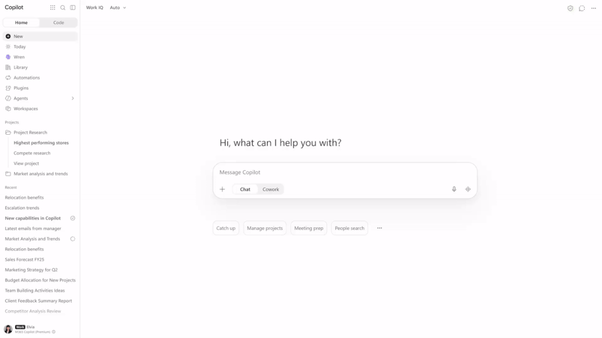
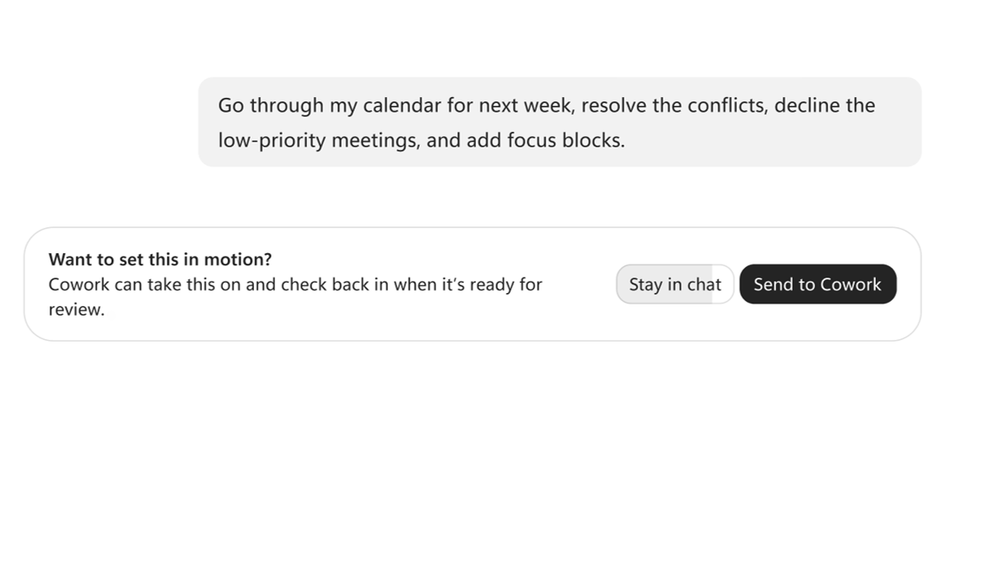
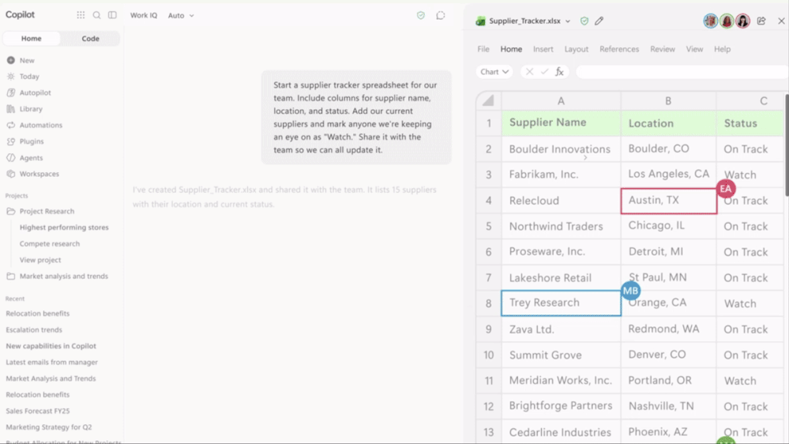
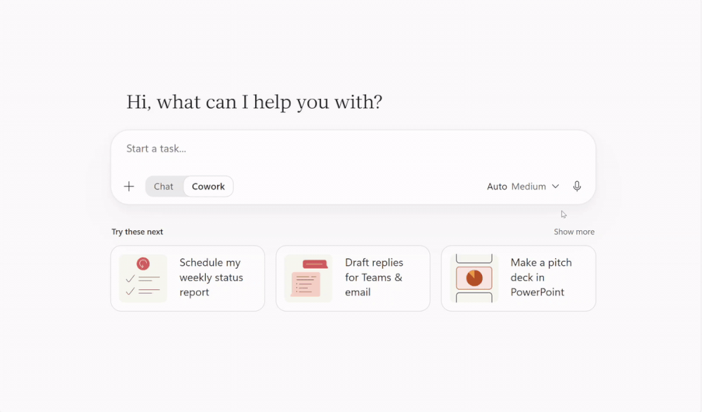
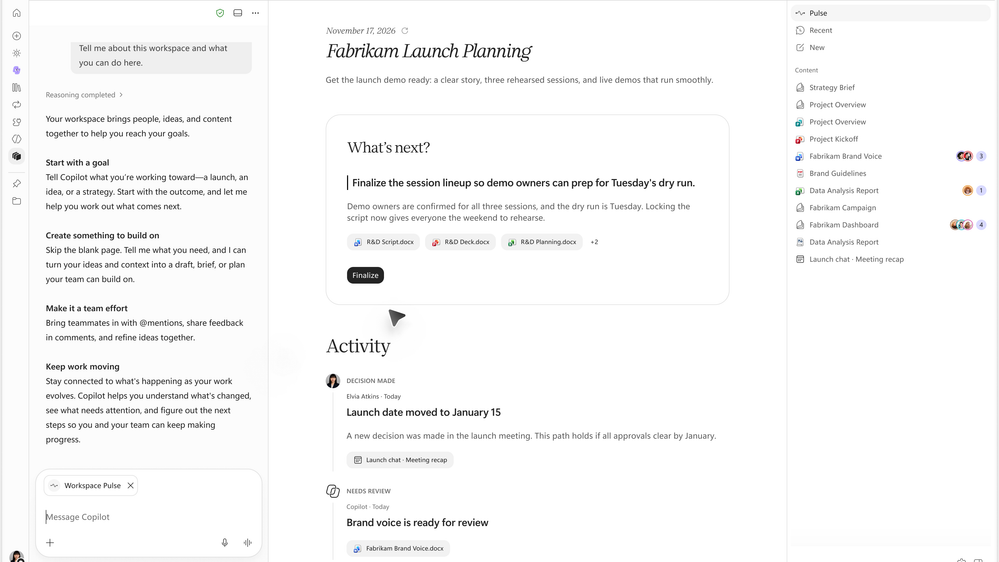
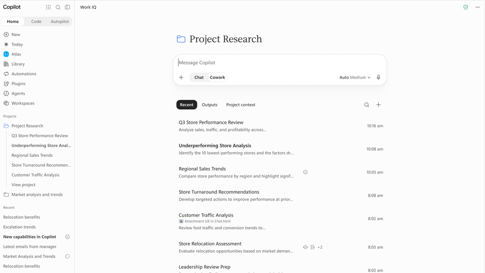
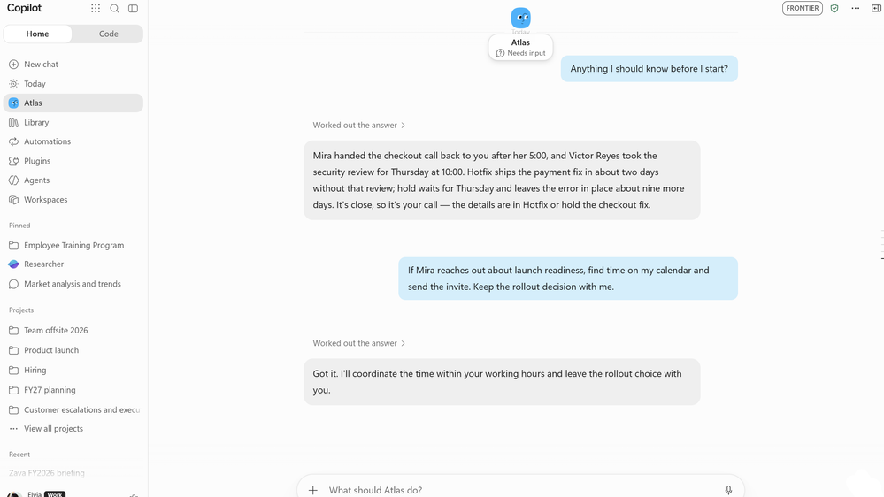

※ この記事は、[Home: Your starting place for work in the Microsoft Copilot app](https://techcommunity.microsoft.com/blog/microsoft-copilot-blog/home-your-starting-place-for-work-in-the-microsoft-copilot-app/4573945) の抄訳です。最新の情報はリンク先をご確認ください。この記事は Microsoft 365 Copilot および GitHub Copilot を使用して抄訳版の作成が行われています。

仕事は、1 回の依頼だけで始まり、終わるとは限りません。ちょっとした質問が文書になり、製品発表の計画が数週間にわたるプロジェクトに発展することもあれば、席を離れた後も進める必要があるタスクもあります。AI がより多くの仕事を担うようになる中、使い始める前に増え続けるツールから選ばなくても、よりシンプルに利用できることが大切です。

今年の Ignite では、Microsoft Copilot アプリの Home の次の段階を発表します。Home は仕事を始める場所です。質問したり、複数の手順からなるタスクを委任したり、対応が必要なことを確認したりできます。プロジェクトとチームのコンテキストをまとめ、Copilot が作成・実行している内容も確認できます。

## 仕事を依頼し、作成し、委任する

Home は、簡単な回答が必要な場合も、完成度の高い文書を作成する場合も、ほかの人に任せられる複数ステップの作業を依頼する場合も、1 つのプロンプト入力欄から始められます。一般提供を開始した Chat と Copilot Cowork (Cowork) をまとめたことで、簡単な質問や最初の下書きの作成から、複雑で複数の手順を伴うタスクの委任まで、スムーズに進められます。Chat と Cowork の会話履歴も 1 か所にまとまります。そのため、朝に Chat で依頼した会議の要約も、後から Cowork に委任した大きな仕事の流れも見つけられます。

Home の Auto は、タスクに適したモデルと処理のレベルを選択します。複雑な作業を委任する場合、Auto は Chat から Cowork への切り替えを提案することもあります。切り替えると、Copilot はプロンプトと関連する Chat のコンテキストを引き継ぐため、タスクをコピーして貼り付けたり、説明し直したりする必要はありません。Chat から Cowork への切り替えの提案は、一般提供を開始しました。

Chat と Cowork を Home にまとめることに加え、どちらのエクスペリエンスにも新機能を順次展開しています。Office の機能をフルに活用できるエクスペリエンスが Chat と Cowork で一般提供となりました。Copilot アプリを離れずに、編集可能な Word、Excel、PowerPoint ファイルを作成してチームと共同作業できます。ファイルは OneDrive に直接保存され、使い慣れたセキュリティとコンプライアンスの制御が適用されます。

タスクに適したモデルと処理のレベルを動的に選択する Cowork の **Auto routing** では、タスクに応じて処理のレベルを自動調整するために [Microsoft-Decision-1.1](https://aka.ms/decision-model-ga) を使用するようになりました。Auto は複雑な作業を複数のサブエージェントに分割し、それぞれを並行して実行します。各サブエージェントは個別の要件に合わせてモデルを選び、最後に結果をまとめて 1 つの成果物に仕上げます。Cowork の Auto routing は、今週 Frontier への展開を開始します。Cowork の詳細は[ブログ](https://aka.ms/cowork-ignite2026)をご覧ください。

## 対応が必要なことを把握する

仕事は、必ずしもプロンプトから始める必要はありません。Home の新しい **Today** ビューは、アプリをまたいで優先事項を探す時間を減らせるよう、先回りした支援を提供します。Today はメール、予定表、Teams、会議、Cowork のタスクを横断して確認できるコマンド センターです。Copilot アプリと Outlook で、Frontier のプライベート プレビューとして利用できます。Today は対応が必要なことを先回りして示し、確認と承認のための下書きや提案を準備します。プロンプトを入力する必要はありません。

*注: Today の最終的なデザインは変更される可能性があります。*

## 関連する仕事をまとめる

仕事は 1 回の会話で終わらず、その後も続くことがあります。Copilot Workspaces と Projects は、チームで共有する仕事も個人の仕事も、Home でコンテキストをまとめて管理します。**Copilot Notebooks の進化形である Copilot Workspaces** を使うと、チームや Copilot と共同作業しやすくなります。Workspaces は、継続的な仕事の流れに必要なコンテキスト、共同作業者、作業中のファイルを、Copilot アプリ内の共有スペースにまとめます。現在の仕事の流れに基づいて提案されるワークスペースからすぐに始められます。さまざまな文書でチームと共同作業し、チーム メンバーが何に取り組んでいるかをリアルタイムのプレゼンスで確認できます。チーム メンバーがファイルを作成したり更新したりすると、Copilot が Workspace 内の情報をつなぎ合わせ、変更点や未完了の項目を表示します。全員が同じ状況を把握できます。Workspaces は Frontier で利用可能になりました。

一般提供を開始した **Projects** は、関連する Chat の会話、Cowork のタスク、成果物を Copilot アプリ内にまとめます。手順と関連する情報源を一度追加しておけば、コンテキストを設定し直したり、Copilot とのやり取りを見失ったりせずに、プロジェクトに戻って新しいチャットやタスクを始められます。Projects は、最初に追加したコンテキストを参照し、次に Microsoft 365 のより広い仕事のコンテキストを活用して、関連性の高い結果を提供します。成果物はプロジェクト内に一覧表示され、OneDrive に保存されるため、簡単に見つけて共有し、さらに編集を重ねられます。

## AI の作業を 1 か所で追跡・管理する

Copilot がさまざまな形でより多くの仕事を担うようになると、Home は Copilot が作成したものや、自律的に実行していることを追跡・管理する場所になります。継続的な作業を自動化する **Autopilot** は、Home からアクセスできるようになり、Frontier への展開が始まっています。Autopilot は、独自の ID、メモリ、ツールを持つ、個人向けの先回り型エージェントです。バックグラウンドで作業を進めます。Home から Autopilot とチャットしたり、アプリをまたいだアクティビティを追跡したりできます。詳細は[Autopilot のブログ](https://aka.ms/autopilot-MTC-blog)をご覧ください。

一般提供を開始した **Automations** は、Chat と Cowork にまたがる、スケジュール済みや進行中の Copilot タスクを 1 か所で管理できます。実行中のタスクを確認して変更を加えたり、関連する Copilot の会話を Automations から直接開いたりできます。

Copilot により多くの機能を取り込む中で、簡単で直感的に使えることも大切にしています。Copilot アプリの Home は、会話、タスク、コンテキストへの共通の入口となります。作業を中断したところから再開し、仕事を進められます。
