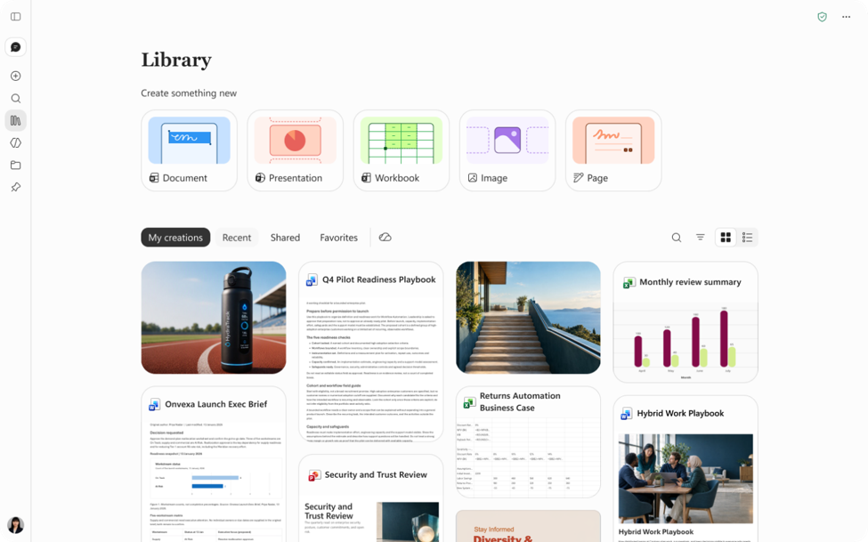

※ この記事は、[Introducing Office in the new Microsoft Copilot app](https://techcommunity.microsoft.com/blog/microsoft-copilot-blog/introducing-office-in-the-new-microsoft-copilot-app/4561230) の抄訳です。最新の情報はリンク先をご確認ください。この記事は Microsoft 365 Copilot および GitHub Copilot を使用して抄訳版の作成が行われています。

Microsoft Office は、PC 時代の生産性のあり方を形作り、デスクトップ ソフトウェアからクラウド コンピューティングや共同作業中心の働き方への移行を後押ししてきました。今、Microsoft Copilot によって、AI 時代の生産性のあり方を形作っています。Copilot アプリは、やりたいことを成果につなげられる場所です。アイデアを出発点に、AI と協力して完成まで進められます。

本日、Office の強力な機能を Copilot アプリに取り込み、Word、Excel、PowerPoint の豊富な作成・共同作業機能と、AI を中心とした働き方を組み合わせます。Chat または Copilot Cowork (Cowork) のどちらからでも、アイデアを掘り下げたり最初の下書きを作成したりして、そのまま同じ環境で編集や共同作業を続けられます。Office in Copilot 内で作業を続ける場合も、単体のアプリに切り替える場合も、文脈を失うことなく、アイデアから完成した文書、スプレッドシート、プレゼンテーションへと仕上げられます。

こうした連続性が重要なのは、仕事が複雑なことが多いためです。文書には複数の担当者が関わり、プレゼンテーションはブランドに沿ったテンプレートを基に作成され、スプレッドシートは重要なビジネス上の意思決定を支えています。Office が Copilot に組み込まれることで、AI を活用したワークフローを離れることなく、使い慣れた編集機能、再現性、共同作業機能を利用できます。

Copilot は、こうしたワークフローの中で柔軟な選択肢も提供します。目の前のタスクに最適なモデルを自分で選ぶことも、Auto に任せて適切なモデルを自動的に選択することもできます。

<iframe src="https://medius.microsoft.com/Embed/video-nc/77f0c927-3291-49eb-8198-8eb69732c7a7?r=854258074693" title="Office in Copilot" allow="autoplay 'none'" allowfullscreen="allowfullscreen" frameborder="0" style="position: absolute; top: 0; left: 0; width: 100%; height: 100%;" sandbox="allow-scripts allow-same-origin allow-forms"></iframe>

## チームワークのための設計

優れた成果が、1 回のプロンプトだけで生まれることはほとんどありません。製品発表の概要資料は作業用の文書へと発展し、予算モデルは前提条件の変化に応じて変わり、プレゼンテーションは何度もフィードバックを受けながら形になっていきます。Copilot アプリは、最初の下書きだけでなく、その過程全体を支えるように設計されています。

たとえば、「この調査メモを基に、エグゼクティブ サマリー、主要なメッセージ、リスク、次のステップを含めた、お客様に提示できる製品発表の概要資料を作成してください」と Copilot に指示します。Copilot が Word 文書を作成し、Copilot との会話の横に並べて表示します。

会話の履歴は保持され、「冒頭をもっと端的にしてください」や「3 つの展開案を比較する表を追加してください」といった追加のプロンプトで、文書を引き続き改善できます。また、すべての編集機能を利用できるため、キャンバス内の使い慣れたコントロールを使って直接編集することもできます。

ほかのメンバーに参加してもらう段階では、組み込みの共有、コメント、共同編集、プレゼンス機能を使い、同じ画面でチームメンバーと作業できます。自分やほかのメンバーが加えた変更は、リアルタイムで表示されます。Copilot はすべてを同じファイルに保持するため、別々の下書きの内容を突き合わせる必要はありません。作成、編集、共同作業を 1 か所でリアルタイムに行える、一体化した環境になります。

## 作業の拠点となる場所

すでに作成したものを基に、次の作業を始めることもあります。Copilot アプリの Library には、Copilot と Office アプリのどちらで作成したかにかかわらず、Word、Excel、PowerPoint の最近使ったファイルに加え、ページや AI で生成した画像もまとめて表示されます。既存のファイルをすばやく見つけて開き直し、Copilot と並べて編集を続けたり、Library から直接、新しい文書、スプレッドシート、プレゼンテーションの作成を始めたりできます。

すべてのファイルが OneDrive に保存されるため、次にどこで作業を再開しても、つながりが保たれます。ファイルの書式、コメント、共有アクセス許可、バージョン履歴は維持され、組織がすでに信頼して利用しているセキュリティ ラベル、コンプライアンス、ガバナンスの制御も引き継がれます。最初のプロンプトからチームによる最新の編集まで、作業内容は同じ使い慣れた Office ファイルに保持され、簡単に見つけて、いつでも続きを進められます。

## Microsoft 365 全体に広がる新しい体験

Microsoft 365 全体で Copilot の改善を続け、Office in Copilot にも最新の機能を取り込んでいきます。

PowerPoint では、Copilot がプレゼンテーションをブランドに沿った状態に自動的に保つのを支援し、スライドや画像の調整、カスタム テンプレートのすばやい適用を簡単にします。Excel では、Copilot が行った編集を確認して変更内容を把握したり、おすすめのグラフを使ってデータを視覚化したりできます。Microsoft 365 全体では、Skills とコネクタにより、Excel での財務分析から Word での法務ワークフローまで、専門知識を作業の流れに直接取り込めます。同時に、再利用可能な役割別の体験を通じて、組織全体にベスト プラクティスを展開できます。これにより、専門的な AI 支援と日常的に使うツールがつながった作業環境が実現します。

## 仕事をするあらゆる場所に Office を

Office は数十年にわたり、アイデアを文書に、データを意思決定に、プレゼンテーションを行動につなげる手助けをしてきました。Copilot が新しい働き方となる中、使い慣れた Office の作成・共同作業体験を、その環境に直接取り込んでいます。

これは、AI と生産性ツールがシームレスに連携する、より統合された体験に向けた新たな一歩です。Copilot アプリでの最初のアイデアから Office アプリでの最終成果物まで、手間を減らし、よりスムーズに、やりたいことを成果につなげられます。

Office in Copilot は、本日から Frontier のお客様向けに、Chat と Cowork で順次提供を開始しています。
