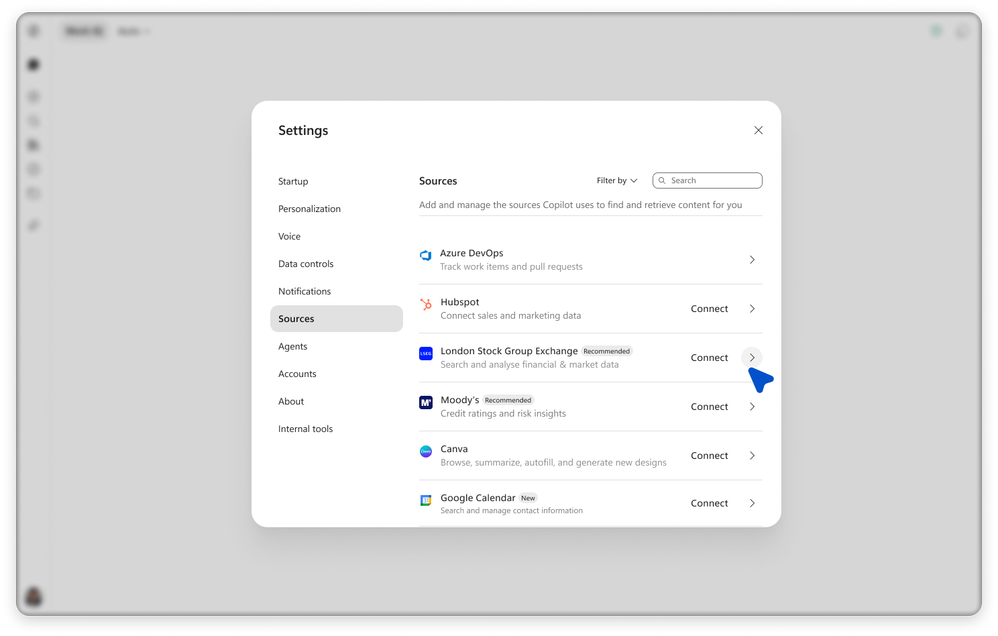
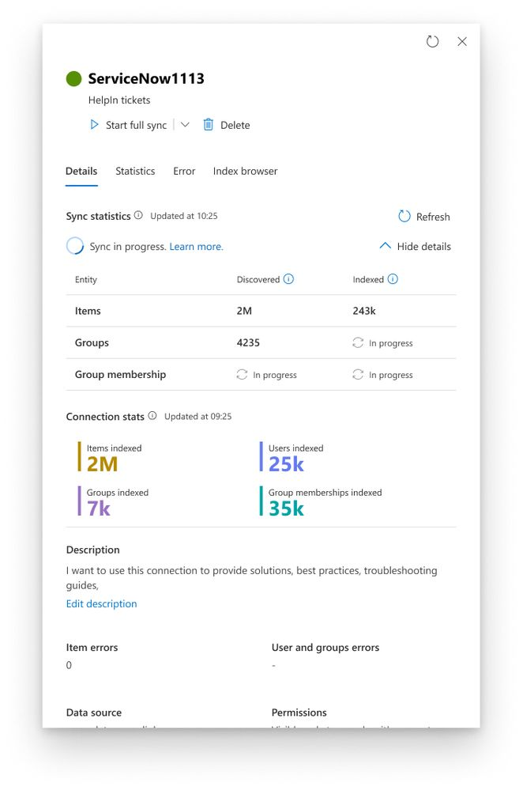

※ この記事は、[Microsoft Copilot Connectors Update: October 2026](https://techcommunity.microsoft.com/blog/microsoft-copilot-blog/microsoft-copilot-connectors-update-october-2026/4572240) の抄訳です。最新の情報はリンク先をご確認ください。この記事は Microsoft 365 Copilot および GitHub Copilot を使用して抄訳版の作成が行われています。

組織のナレッジは、1 か所にまとまっているわけではありません。プロジェクト ボード、CRM レコード、ナレッジ ベース、Wiki、専門的な調査情報などに分散しています。Microsoft Copilot コネクタは、これらを Microsoft Copilot に取り込みます。利用者は、すでに持っているアクセス許可の範囲内で、自分にとって重要なコンテンツを根拠とした回答を得られます。

今月は、コネクタを使える場所の拡大、新たな分野への対応、よく使うシステムからの回答の充実、接続管理の手間を減らす改善を進めています。新機能を紹介します。

## 9 月の概要

- **包括的なコネクタ カタログ:** FactSet、HubSpot、Moody's、Salesforce CRM など、すべてのコネクタが、Microsoft Copilot Chat (Copilot Chat)、Word、Excel、PowerPoint、Researcher 共通の統合カタログに表示されるようになりました。[カタログの全一覧はこちら](https://learn.microsoft.com/microsoft-365/copilot/connectors/connectors-gallery-microsoft)をご覧ください。
- **新しいコネクタ:** Trello Enterprise、HR インサイトを提供する Galileo に加え、PubMed、ClinicalTrials.gov、bioRxiv、ChEMBL など、研究、臨床、規制、医薬品データを扱う 25 を超える医療・ライフ サイエンス向けコネクタが加わります。
- **コネクタ向けスキル:** 新しいコネクタ スキルは、アプリ固有の知識を Copilot に取り込み、Copilot 内でワークフローを完了できるように支援します。まず HubSpot と Notion で提供し、今後さらに多くのコネクタに拡大します。また、新たに Tasks に対応し、LexisNexis、Bloomberg、Thomson Reuters などのプロバイダーが提供する、実行に時間のかかるツールを Copilot で実行できるようになりました。
- **グラウンディングで、より関連性の高い回答を取得:** Source Filter で 1 つ以上の情報源を選び、設定から情報源を見つけて接続できます。回答に含まれなかったコネクタのコンテンツも、1 回のクリックで回答に取り込めます。これにより、Copilot が適切なコンテキストを使い、不要な情報を減らせます。

**皆さまの声を受けて改善しました!**

- **Salesforce、ServiceNow、Confluence から、より充実した安全な回答を取得:** Salesforce はカスタム フィールドや追加のオブジェクトに対応し、対象範囲を拡大します。ServiceNow は、より長いプロパティ名と、最大 64 MB のナレッジ ベースの添付ファイルに対応します。Confluence は、ページのコメント、添付ファイル、メタデータを取り込むとともに、ID の照合精度を高め、回答の品質を改善します。
- **接続を簡単に管理:** 管理者向けに、組織に合ったコネクタの推奨、公開済み接続の編集、接続診断の改善、すべてのフル クロールでの進捗表示、ライフサイクルに応じたメール通知を提供します。

## より多くの業務情報を Copilot に取り込む

#### すべての Copilot の利用画面で使える、包括的なコネクタ カタログ

すべてのコネクタが共有プラグイン レジストリに組み込まれ、Copilot の各機能で 1 つの統合カタログを使えるようになりました。承認済みのコネクタ、スキル、業務データを 1 か所で見つけて利用できます。すべてが一貫した信頼と制御のモデルに従うため、製品ごとに別々のカタログを管理する必要はありません。

**特に重要なのは、Microsoft Copilot の各利用画面で、同じ一貫したコネクタ カタログが表示されることです。** すべてのコネクタは、Microsoft Copilot Chat、Word、Excel、PowerPoint、Researcher で動作します。どこで作業していても、使い慣れた操作でコネクタを見つけて利用できます。サインイン、同意、接続管理、サインインの復旧も、認証基盤によらず同じように動作し、一貫した信頼性とパフォーマンスを提供します。[カタログの全一覧はこちら](https://learn.microsoft.com/microsoft-365/copilot/connectors/connectors-gallery-microsoft)をご覧ください。

#### 新たに対応する分野: HR、ライフ サイエンス、プロジェクト業務

**· Trello Enterprise**

Microsoft Copilot と Search で、Trello のボード、カード、プロジェクトのコンテキストを検索して利用でき、アプリを切り替える手間を減らせます。企業向けに設計された、本番環境での利用をサポートするコネクタです。利用者には、Trello でアクセスを許可されている情報だけが表示されます。

**· 多数の新しい医療・ライフ サイエンス向けコネクタ**

研究者や臨床・規制関連のチームは、作業の流れを中断せずに、生物医学、臨床、規制、ライフ サイエンス分野の主要な情報源を Copilot の回答の根拠として活用できるようになりました。Microsoft 製とパートナー製のコネクタが含まれます。対象は、PubMed、ClinicalTrials.gov、bioRxiv、ChEMBL、Open Targets、MedlinePlus、RxNorm & Drug Classes、ICD-10、CMS Coverage、CMS NPI Registry、Drug Pricing (CMS/Medicaid)、FDA Safety (openFDA)、Article Galaxy、Scite、Consensus、NyquistAI、PopHIVE、SciLeads、Cortellis Regulatory Intelligence、smarts.bio、BioRender、Amass、CAS Connections、DrugBank、Sage Bionetworks です。

**· The Josh Bersin Company の Galileo**

初のデータ プロバイダー コネクタにより、The Josh Bersin Company の調査に裏付けられた HR インサイトを Microsoft Copilot に直接取り込めます。HR チームやマネージャーは、十分な情報に基づいて意思決定を行い、調査を根拠とした戦略、ポリシー、プレゼンテーション、従業員向けのコミュニケーションをすばやく作成できます。

#### コネクタ向けスキル: 回答からワークフローの完了へ

コネクタ スキルは、利用者の質問に基づいて回答を返すだけにとどまりません。アプリ固有のノウハウを使って企業のナレッジを基に推論し、複雑なプロンプトを使わなくても、実際の仕事の進め方に合った回答を生成します。プラグインの利用画面で簡単に見つけることができ、アクセスを管理し、品質を検証したうえで一貫して展開されます。現在は Notion と HubSpot で提供されており、近日中にさらに多くのコネクタへ拡大します。

<iframe src="https://medius.microsoft.com/Embed/video-nc/15762992-5a9d-42e9-aa46-92b91e0441ce?r=189524913213" title="Skills in Cowork" allow="autoplay 'none'" allowfullscreen="allowfullscreen" frameborder="0" style="position: absolute; top: 0; left: 0; width: 100%; height: 100%;" sandbox="allow-scripts allow-same-origin allow-forms"></iframe>

#### Tasks による、実行に時間のかかるコネクタ アクション

特に価値の高い作業の中には、数秒では終わらないものもあります。Tasks により、Copilot は、実行に数秒ではなく数分かかるフェデレーション コネクタのツールを実行し、その間の進捗を表示できるようになりました。時間のかかる処理も、待たされていると感じにくい形で完了できます。最新の MCP 仕様に基づき、後方互換性も備えた Tasks により、LexisNexis、Power BI、Fabric、Bloomberg、Wolters Kluwer、Thomson Reuters などのコネクタを利用できるようになります。

#### 自分に合った情報源を使う

適切な回答を得るには、適切な情報源が必要です。今月の更新では、Copilot が参照する場所をより細かく制御でき、作業を中断せずに使えるようになります。

**Source Filter: 選択した情報源を根拠とする回答**

Copilot への質問の対象を、1 つ以上の特定の情報源に絞り込めます。より関連性が高く、不要な情報の少ない結果を得られます。組み込みの検索で、適切な情報源をすばやく見つけられます。

**設定の Sources メニュー**

すべての情報源を 1 か所にまとめます。カタログが拡大しても、設定の 1 つの一覧から、Copilot が利用できるデータ ソースを検索、確認し、接続できます。

#### コンテキストに応じたコネクタの提案

関連するコネクタのコンテンツを見逃さずに利用できます。Copilot が見つけたコネクタの検索結果が回答に含まれなかった場合、提案を 1 回クリックするだけで、その結果を取り込めます。質問を言い換える必要はありません。

#### フェデレーション コネクタのインライン再認証

作業を中断せずに続けられます。セッションが期限切れになると、Copilot は利用者の操作なしで、または簡単なインライン サインインで復旧します。別のサインイン ページへ移動することなく、作業内容とコンテキストを保持できます。

## Salesforce、ServiceNow、Confluence から、より充実した安全な回答を取得

チームが日々使うシステムから、Copilot でより充実した正確な回答を得られるようになりました。

#### Salesforce CRM

営業チームやサービス チームは、対象範囲の拡大とパフォーマンスの改善により、関連する Salesforce CRM の情報を Copilot 内で見つけられます。コネクタは、カスタム フィールドに加え、Tasks、Events、Campaigns、Campaign Members、Comments、Attachments などの追加のオブジェクトやコンテンツに対応しました。フィールド レベル セキュリティ、レコード レベルのアクセス制御、PKCE セキュリティへの対応準備により、セキュリティも強化されています。

#### ServiceNow Tickets と KB

ServiceNow のチケットの検索結果が、より充実します。プロパティ名の 32 文字の制限が撤廃され、より長い名前を扱えるようになったため、以前は表現できなかったスキーマも使えます。ACL フィールドの対応範囲が拡大し、アクセス許可をより正確に反映した結果が得られます。また、システム タグがコレクションとして保存されるようになり、元のメタデータをより適切に保持できます。

ServiceNow KB の添付ファイルの上限は、20 MB から 64 MB に拡大しました。詳細な文書、プレゼンテーションなどの大きなナレッジ アセットも、サイズを縮小したり除外したりせずに、Copilot の回答で利用できるようになりました。

#### Confluence

- より充実した回答: Copilot は、Confluence Cloud のページ コメント、添付ファイル、そのメタデータを利用するようになりました。回答に、ページに関するやり取り全体が反映されます。
- 適切な人に適切なコンテンツを提供: ID の照合精度の向上により、Copilot は Confluence のアクセス許可をより正確に尊重します。
- 中断を削減: アクセスが更新される際も、接続は安定してサインイン状態を維持します。大規模なグループを持つ組織でも、コンテンツの同期が続きます。
- 問題発生時にすばやく対処: サインインやクロールのエラーについて、明確なメッセージとトラブルシューティングの手順を提供します。オンプレミスの Confluence では、すべてのフル クロールで進捗を追跡できます。

## 管理者向け: 手間のかからないコネクタ管理

接続の管理をもっと簡単にしたいという声が、多くの皆さまから寄せられています。管理者向けの新機能を紹介します。

#### 組織に合わせたコネクタの推奨

管理者には、固定の一覧ではなく、組織に合わせたコネクタの推奨が表示されるようになりました。利用者にとって最も関連性の高いコネクタを見つけ、すばやく設定しやすくなります。

#### 最初からやり直さずに接続を編集

管理者は、公開済みの接続を削除して作り直す代わりに、そのすべての設定を編集できるようになりました。データ ソースのフル再クロールは不要で、これまでに収集したアクティビティ シグナルも失われません。接続 ID も変わらないため、その接続を基に作成したエージェントが動作しなくなることもありません。メタデータの編集は、すぐに保存されます。アクセス許可 (ACL) の変更は、すばやいアドホック クロールで自動的に適用されます。その他の変更では、すぐにクロールするか、次回のスケジュールされたクロールで適用するかを選べます。

#### 接続診断の改善

接続に失敗すると、管理者には、一般的な失敗通知ではなく、状況に即した明確なエラー メッセージと、次に行う操作の提案が表示されるようになりました。各メッセージは、データ ソースが返したエラー情報に基づいて何が問題だったかを説明し、解決方法を提案します。これにより、コンテンツの取り込みをより早く再開できます。対応するコネクタは増えており、今後も追加されます。

#### すべてのフル クロールで進捗を表示

接続の初回クロールの進捗は、すでに確認できました。管理者は、以降のスケジュールされたフル クロールも、実行中に追跡できるようになりました。管理がしやすくなり、診断もすばやく行えます。接続の詳細には、アイテム、グループ、グループ メンバーシップの進捗がリアルタイムで表示され、自動的に更新されます。時間のかかるクロールも停止しているようには見えず、問題を早期に発見できます。

#### 先を見越したメール通知

管理者には、コネクタのライフサイクルにおける重要なタイミングで、メールが届くようになりました。

- Microsoft Graph connector agent (GCA) の更新: GCA の新しいリリースが利用可能になるとすぐに通知され、アップグレードが必要なときにはリマインダーが届きます。展開を早めに計画し、オンプレミスのコネクタを最新の状態に保てます。
- 初回フル クロールの完了: コネクタのコンテンツが利用可能になったことが通知され、すぐに利用と検証を始められます。

## 使い始める

- Microsoft 365 管理センターで[コネクタ カタログを確認](https://learn.microsoft.com/microsoft-365/copilot/connectors/connectors-gallery-microsoft)
- [Copilot コネクタの詳細](https://learn.microsoft.com/microsoft-365/copilot/connectors)

## フィードバックをお寄せください

今回の更新への感想や、今後期待する機能をお知らせください。原文記事のコメント欄でフィードバックを共有して、要望の把握と対応にご協力ください。
