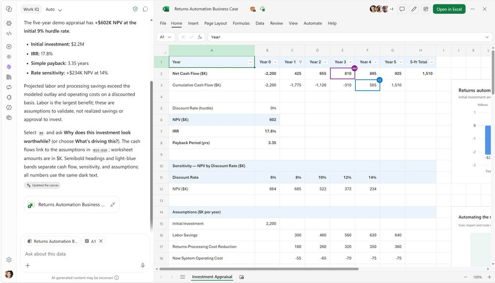
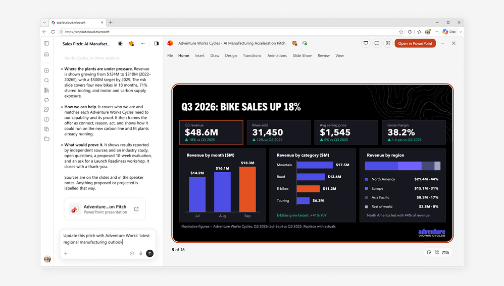
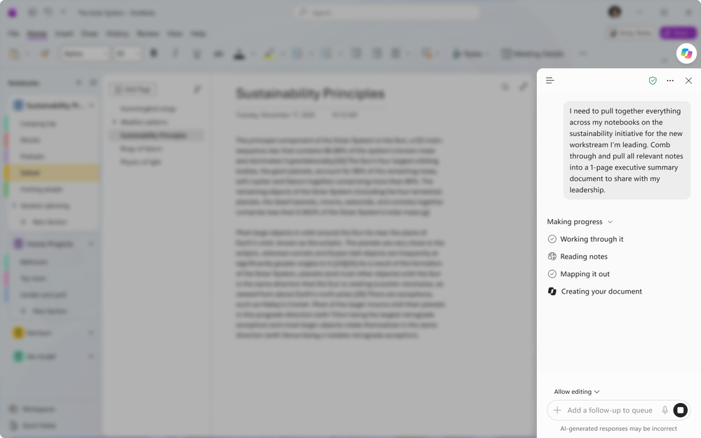
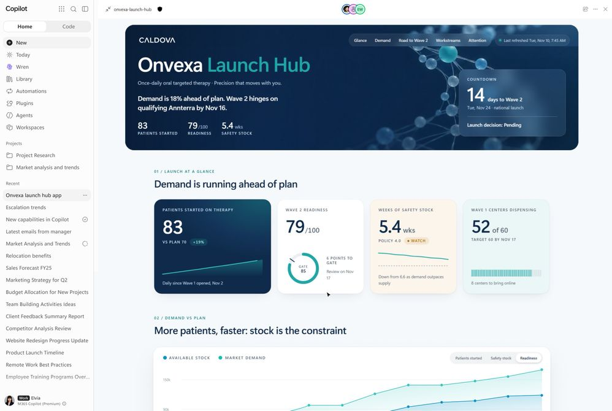

※ この記事は、[Office at Ignite 2026: From apps to agentic system of work](https://techcommunity.microsoft.com/blog/microsoft-copilot-blog/office-at-ignite-2026-from-apps-to-agentic-system-of-work/4572226) の抄訳です。最新の情報はリンク先をご確認ください。この記事は Microsoft 365 Copilot および GitHub Copilot を使用して抄訳版の作成が行われています。

仕事は、もはや分断された環境の中だけで進めるものではありません。1 つのプロジェクトが AI チャットへの質問から始まり、Word の下書きになり、PowerPoint のプレゼンテーションへと形を変え、最後はメールのやり取りの中で意思決定に至ることもあります。その各段階で、作業のコンテキストも AI も引き継がれることが期待されています。[Ignite](https://aka.ms/MicrosoftIgnite26Blog) では、Office の次の段階を紹介します。Office はアプリの集合から、人が主導するエージェント型の仕事の仕組みへと進化しています。作成、編集、共同作業を Copilot に取り込み、Office アプリへのスムーズな引き継ぎを実現します。スキルとコネクタがワークフローをつなぎ、Today、Pages、Workspaces によって、Copilot がより先回りして仕事を支え、共同作業を進められるようになります。どこから作業を始めても、主導権は利用者の皆さまが持ち、AI がより多くの作業を担います。

## Office の豊富な機能を Copilot アプリに

**Copilot アプリの Office: 会話から作成、そして共同作業へ。** [Copilot アプリの Office](/blog/introducing-office-in-the-new-microsoft-copilot-app/) は、本日から一般提供されます。調査メモを製品発表の概要資料にまとめるよう Copilot に依頼すると、会話の横に Word 文書が開きます。プロンプトで文書を整えることも、文書内をクリックして自分で編集することもできます。Excel の予算モデルや、PowerPoint のブランドに沿ったプレゼンテーションでも同様です。チームメンバーに参加してもらい、リアルタイムの編集や共同編集を行えます。必要なときには、Copilot アプリから豊富な機能を備えた Office アプリへ切り替えられます。すべてのファイルは OneDrive に保存され、組織がすでに信頼して利用しているセキュリティとコンプライアンスの制御が適用されます。

## ワークフローをまたいで専門知識とコンテキストをつなぐ

仕事に最適なモデル、対話型コンテンツ、新しいスキルとコネクタを取り入れ、Office アプリの Copilot エクスペリエンスを引き続き改善しています。また、Office と Copilot のワークフローをつなぎ、必要なツールやコンテキストを引き継ぎながら、タスクやアプリを切り替えられるようにしています。

**新しい職種別ソリューション: Copilot for sales (Frontier Public)** チームによって仕事の進め方は異なります。スキル、プラグイン、コネクタは、専門知識を Copilot と Office アプリに取り込みます。これにより、チームは使い慣れたツールやワークフローを使い、データも統合された状態で仕事を進められます。先日発表した [Copilot for legal](/blog/introducing-microsoft-copilot-for-legal/) と [Copilot for finance](https://www.microsoft.com/en-us/copilot/blog/2026/10/29/microsoft-copilot-for-finance-purpose-built-for-the-way-finance-teams-work/) に続き、今回 Copilot for sales を発表します。

Copilot では、接続された CRM データと営業担当者の Work IQ を活用する[営業スキル](https://aka.ms/pptsalesskills)を提供しています。顧客との会議の準備、顧客に提示できるコンテンツの作成、営業パイプラインの中で注力すべき案件の絞り込みを支援します。PowerPoint では、よくあるワークフロー向けのスキルを使い、CRM の情報を基に個別の顧客に合わせた提案プレゼンテーションを作成できます。また、実績のあるコンテンツを新しい顧客向けに調整したり、主張の根拠を情報源で確認した提案書を作成したりできます。Copilot Cowork (Cowork) でも同じスキルを使い、意思決定者や案件の最新情報をまとめた概要資料で会議に備えられます。リスクのある案件を見つけ、停滞する前に対応することもできます。

営業スキルは複数の CRM システムに対応し、Zendesk、HubSpot、Frontify、Cloudinary、Seismic、Notion、Clay、Granola、Monday.com、DocuSign、ZoomInfo などのツールと接続します。PowerPoint と Cowork 向けの営業スキルは、1 つのプラグインにまとめて提供される予定です。取り組みはまだ始まったばかりです。お客様から学びながら、これらのスキルを引き続き拡充していきます。

### メモから Word、Excel、PowerPoint ファイルの最初の下書きを作成: Copilot in OneNote (Frontier Public)

一度記録したメモを、そのまま成果物の作成につなげられます。Copilot in OneNote を使うと、メモを整理してまとめ、Word、Excel、PowerPoint ファイルに変換できます。たとえば、1 週間にわたって顧客とやり取りした後、会議メモを基に、顧客に提示できる FAQ を Word で作成するよう Copilot に依頼します。その後、メモのコンテキストがすでに含まれた文書を Word で開き、仕上げられます。メモから Excel のプロジェクトのタイムラインや、PowerPoint の提案資料を作成することもできます。コンテキストの収集や資料の準備にかかる時間を減らし、活用する時間を増やせます。

## 先回りした支援と共同作業で仕事を進める

Office の基盤の上に、Today、Pages、Workspaces が、仕事を進める 3 つの新しい方法を提供します。Today は注意を向けるべき事項の優先順位付けを支援し、Pages は成果物の作成や具体化を支援します。Workspaces はチーム、共有コンテキスト、Copilot をまとめることで、継続的な進捗を支えます。

**受信トレイの管理から、仕事を進めるための支援へ: Today (Frontier Private)。** Today は、メール、予定表、チャット、会議から得られるシグナルを基に、重要な事項を個人に合わせたビューにまとめます。メールの下書き、チャット メッセージ、日程調整の提案も、確認、調整、承認できるよう準備されています。朝の時間を情報の整理や、何から始めるかの判断に費やす代わりに、意思決定に役立つ関連コンテキストを使い、仕事を進めることに集中できます。Today は Outlook と Copilot に直接組み込まれており、プロンプトの入力、エージェントの設定、ワークフローの構成なしで、すぐに使えます。

<iframe src="https://medius.microsoft.com/Embed/video-nc/8f3c44a2-14e8-404e-9ea3-15aafd489c4d?r=494111055567" title="Today" allow="autoplay 'none'" allowfullscreen="allowfullscreen" frameborder="0" style="position: absolute; top: 0; left: 0; width: 100%; height: 100%;" sandbox="allow-scripts allow-same-origin allow-forms"></iframe>

**AI を活用する仕事のための動的なキャンバス: Pages (Frontier Public)。** Pages は、プロンプトと元の資料を、豊富で対話型のコンテンツに変換します。レポートや概要資料から、対話型ダッシュボードやアニメーションまで、仕事に最適な形式に合わせます。Page を直接編集したり、チームと共同作業したり、Copilot を使ってコンテンツを改善したりできます。エージェントがバックグラウンドでデータを更新し、Page を最新の状態に保ちます。

**継続的な仕事の流れを支える共有スペース: Workspaces (Frontier Public)。** Copilot Notebooks の進化形である Copilot Workspaces は、チーム、仕事、Copilot を 1 か所にまとめ、共同作業と仕事の進行を支援します。**現在取り組んでいる仕事に基づいて提案されるワークスペースから始め、文書で共同作業を進められます。その間、Copilot が関連情報をつなぎ合わせ、変更点、未解決の事項、注意を向ける必要があるアクションを示します。これにより、全員が状況をすばやく把握し、仕事を進め続けられます。**

また、近日中に、チームで Autopilots を Workspaces に取り込めるようになる予定です。人とエージェントが 1 つのスペースで共同作業できるようになり、自分で作業を行うことから、作業を指揮することへと役割を移せます。

<iframe src="https://medius.microsoft.com/Embed/video-nc/ae8b6624-a54c-488f-961e-5c07016592d3?r=426644565176" title="Workspaces" allow="autoplay 'none'" allowfullscreen="allowfullscreen" frameborder="0" style="position: absolute; top: 0; left: 0; width: 100%; height: 100%;" sandbox="allow-scripts allow-same-origin allow-forms"></iframe>

### 人が主導することを前提にした設計

すべての発表に共通する原則は、AI は人を意思決定の輪から外すことなく、仕事を進めるべきだということです。コンテキストを提供し、仕事を導き、判断を下し、成果に責任を持つのは利用者の皆さまです。長年使ってきた Word、Excel、PowerPoint、Outlook を使う場合も、Copilot で新しいことを試す場合も、Office は利用者の皆さまやビジネスの進め方とともに成長しています。これからどのような成果が生まれるのか、楽しみにしています。
