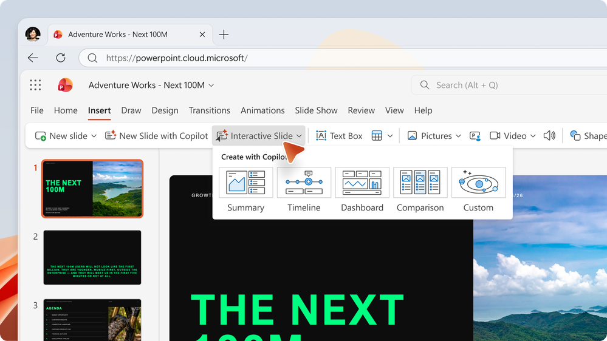
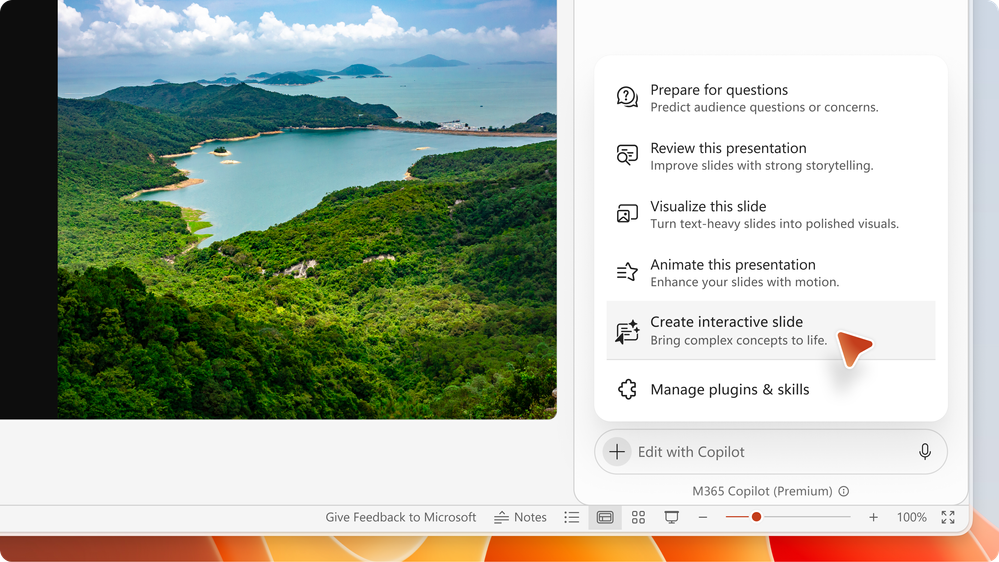

※ この記事は、[Transform your storytelling with interactive slides in PowerPoint](https://techcommunity.microsoft.com/blog/microsoft-copilot-blog/transform-your-storytelling-with-interactive-slides-in-powerpoint/4564287) の抄訳です。最新の情報はリンク先をご確認ください。この記事は Microsoft 365 Copilot および GitHub Copilot を使用して抄訳版の作成が行われています。

プレゼンテーションで最も印象に残るのは、発表者と聞き手が一緒にアイデアを掘り下げられる瞬間です。

PowerPoint では、アイデア、データ、組織に蓄積された知識を、引き込まれるストーリーへと変えるための機能を拡充しています。**対話型スライド**を使うことで、内容を探索できるスライドを通じて、アイデアをより効果的に伝えられます。

### 対話型のストーリーテリングでアイデアを形に

**Create interactive slide** スキルを使うと、Copilot が簡単なプロンプトや既存のコンテンツから対話型スライドを生成します。ダッシュボードのインサイトの紹介、業務プロセスの説明、タイムラインに沿った解説、選択肢の比較など、対話型スライドは、情報を理解しやすく、記憶に残りやすいものにします。

発表者と聞き手は、コンテンツを探索し、インサイトを見つけ、概念を理解しやすくするビジュアルを操作できます。

<iframe src="https://medius.microsoft.com/Embed/video-nc/55ffcb13-160f-4045-83d0-edc619bf34f8?r=1030154141823" title="Interactive Slides" allow="autoplay 'none'" allowfullscreen="allowfullscreen" frameborder="0" style="position: absolute; top: 0; left: 0; width: 100%; height: 100%;" sandbox="allow-scripts allow-same-origin allow-forms"></iframe>

### どのようなものを作れるか

プレゼンテーションには、情報が詰め込まれ、聞き手が圧倒されてしまうスライドが含まれることがあります。対話型スライドは、情報を段階的に表示し、重要なポイントに注意を向けてもらい、より引き込まれる体験を作るのに役立ちます。

Copilot がコンテンツを理解する力と、視覚的で対話型のストーリーテリングを組み合わせることで、複雑な仕組みを一から作る時間を減らしながら、アイデアをより明確に伝えられます。

対話型スライドは、次のような用途に適しています。

- [Work IQ](https://support.microsoft.com/en-us/microsoft-365-copilot/what-information-does-copilot-use-to-answer-my-prompt#what-is-work-iq) による根拠情報も含め、データのスナップショットに基づくダッシュボードの作成
- 対話型のタイムラインやプロセス フローの作成
- 視覚的な探索を通じた、複雑な概念の要約や説明
- 製品、シナリオ、戦略の比較

### 試してみる

使い始めるのは簡単です。PowerPoint のリボンから **Interactive Slide** を選択し、作成したいスライドを説明します。プレゼンテーション内のコンテンツや、Excel ブック、Word 文書など、ほかのファイルやコンテキストを参照できます。

Copilot のスキル選択メニューからも、ほかの PowerPoint スキルとともに **Create interactive slide** にアクセスできます。

### 提供状況

**Create interactive slide** スキルとリボンのボタンは、現在、順次展開されています。

- Windows 版および Mac 版 PowerPoint の最新チャネル (Current Channel) と月次エンタープライズ チャネルで展開が進んでおり、2026 年 10 月末までに完了する予定です。
- Web 版 PowerPoint でも展開が進んでおり、2026 年 10 月末までに完了する予定です。

最新の更新情報を含む、このスキルの詳細は、次のページをご覧ください。

[https://support.microsoft.com/en-us/powerpoint/copilot/create-interactive-slides-with-copilot-in-powerpoint](https://support.microsoft.com/en-us/powerpoint/copilot/create-interactive-slides-with-copilot-in-powerpoint)

魅力的なプレゼンテーションを、よりすばやく作成・改善・発表するのに役立つ、PowerPoint のほかの Copilot スキルについては、次のページをご覧ください。

[https://support.microsoft.com/en-us/powerpoint/edit-with-copilot-in-powerpoint](https://support.microsoft.com/en-us/powerpoint/edit-with-copilot-in-powerpoint)
