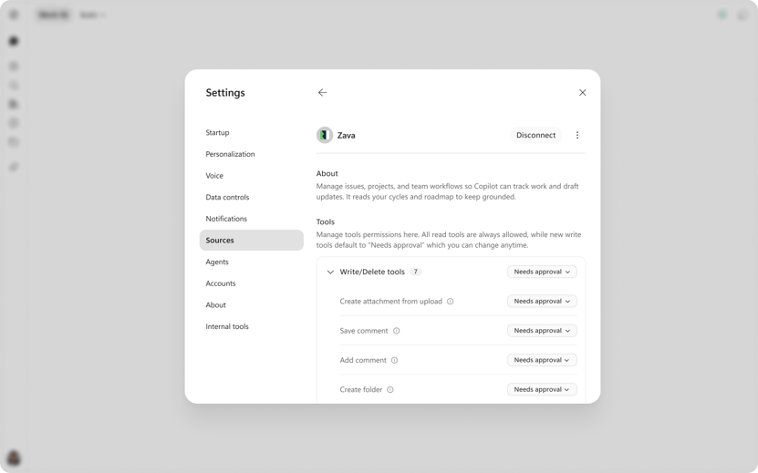
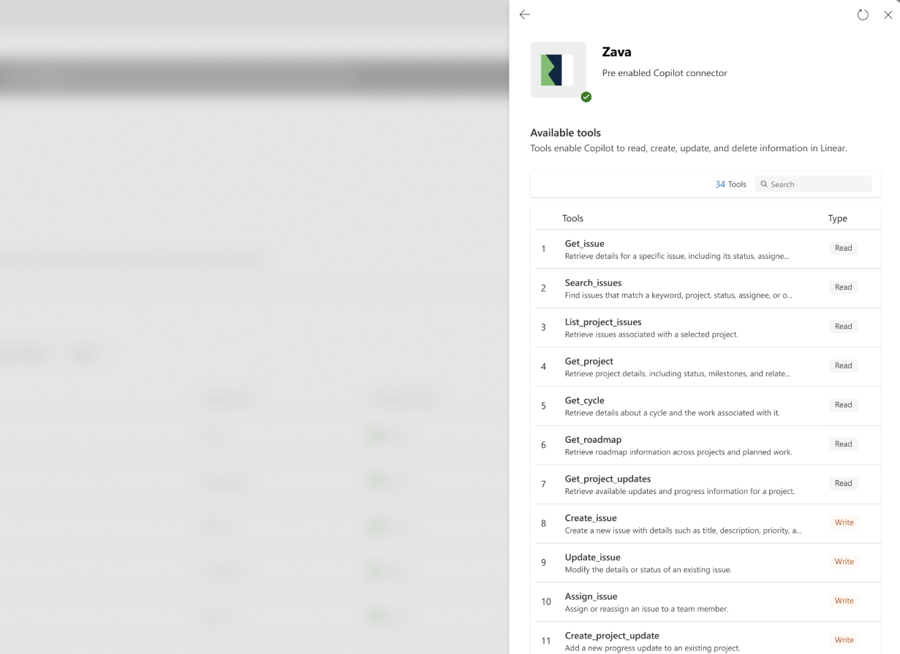

※ この記事は、[Turn Copilot insights into action with connector write capabilities](https://techcommunity.microsoft.com/blog/microsoft-copilot-blog/turn-copilot-insights-into-action-with-connector-write-capabilities/4571160) の抄訳です。最新の情報はリンク先をご確認ください。この記事は Microsoft 365 Copilot および GitHub Copilot を使用して抄訳版の作成が行われています。

Copilot コネクタの書き込みアクションが、Microsoft Copilot Chat (Copilot Chat) と Copilot Cowork (Cowork) で一般提供されました。Microsoft 製、パートナー製、カスタム開発を合わせて数百のコネクタを利用でき、会話の中で自然な言葉で依頼して、接続先アプリの情報を作成、更新、削除できます。提案された操作を確認して承認すると、Copilot が実行します。Office アプリの Copilot にも近日中に提供予定です。1

<iframe src="https://medius.microsoft.com/Embed/video-nc/5e5de408-1d80-4899-80be-416cd999376a?r=375224925314" title="FCC Connectors" allow="autoplay 'none'" allowfullscreen="allowfullscreen" frameborder="0" style="position: absolute; top: 0; left: 0; width: 100%; height: 100%;" sandbox="allow-scripts allow-same-origin allow-forms"></iframe>

## Copilot コネクタで Work IQ のコンテキストをアプリの操作に活用

会話のコンテキストを基に、組織のデータがあるアプリで情報を作成、更新できます。たとえば、次のような使い方があります。

- Teams 会議のトランスクリプトから、CRM の活動記録とフォローアップ タスクを作成。
- 毎朝の Outlook のエスカレーションを、要約とラベル付きの製品課題に整理。
- 作成した文書を紹介するグラフィックを Canva で作成。
- Excel ブックの承認済みの行から、接続先の会計システムにレコードを作成。

## 書き込みアクションで広がる活用例

コネクタの書き込み、更新機能を使うと、次のような作業にも Copilot を活用できます。

**チケットの作成と更新 – Atlassian Rovo**

Jira の作業情報や Confluence のナレッジを使い、Copilot 内でチケットを作成、更新できます。

- 製品レビュー会議のトランスクリプトから、合意した機能ごとの作業項目を Jira の mobile プロジェクトに作成し、議論した受け入れ条件を追加。
- 課題を探し、メール返信や文書の作成につなげる。checkout ラベルの付いた未解決の Jira バグに、メール スレッドで判明した根本原因を追記し、修正内容を Confluence の Engineering スペースにまとめる。

**文書の更新 – Notion**

対応する書き込みアクションを使い、Copilot Chat から Notion の文書やデータベースを直接更新できます。

- 要件を確認する打ち合わせを要約し、課題、提案するスコープ、未解決の質問を含む仕様をまとめるページを作成して、状態を Draft に設定。
- 展開チームの今週の進捗メールを確認し、マイルストーンに遅れがあれば Q4 展開ページを At Risk に変更。変更点を日付付きで追記。

**アイデアをデザインに – Canva**

テンプレート、デザイン、チームのフィードバックを活用し、アイデアや既存コンテンツを統一感のあるビジュアルにできます。

- 暖色系と少ないテキストで、春の製品発売を知らせる Instagram 投稿を作成。
- 文書の主要な統計 3 点を取り上げ、それぞれをグラフィックにする。
- デザインに寄せられたコメントを読み、チームが求めた変更を反映。

**キャンペーンの作成 – G2**

キャンペーンの依頼と補足資料を基に、計画、資金の確認、作成、状況確認を進められます。まず提案を確認し、承認後にキャンペーンを作成します。

- \[X\] 件のレビューと $[Y] の条件で資金を確認し、チームが招待を送る構成と資金の手配内容を承認用に提示。この段階では作成しないよう指定。
- レビュー依頼の進め方はチームが管理し、G2 Marketing Solutions の「Q4 Customer Reviews」を作成し、インセンティブなしで G2 から alex@contoso.com に送信。開始日は次の火曜日に指定。

**法務文書の下書き – iManage**

契約の内容を基に、新しい業務の作業指示書を下書きし、元の契約を変更せずに結果を確認できます。

- Celestia Clinical と Acme の基本サービス契約 (MSA) を探し、発効日と保存先の案件を確認。
- その MSA に基づき、新しい臨床研究の作業指示書に対応する作業範囲記述書 (SOW) を下書き。同じ案件に「Celestia Clinical–Acme SOW – New Work Order」として保存し、不明なスコープ、料金、日付は To be confirmed と記載。MSA は変更しない。

**科学的な概念を図に – BioRender**

科学分野のテンプレートや図の作成機能を使い、概念を一貫した図で表現できます。元の図を変えずに、異なる対象者向けに調整することもできます。

- 治療戦略の比較に使える HER2 受容体阻害のテンプレートを検索。
- 最初のテンプレートを、二量体化を阻害する抗体、低分子キナーゼ阻害剤、抗体薬物複合体という 3 つの HER2 標的戦略を比較する 3 パネルの図に変更。

## Copilot の操作と実行タイミングを管理

既定では、Copilot が情報を作成、更新、削除する前に許可を求めます。確認カードには、使用するコネクタとツール、送信する情報が表示されるため、認証済みの外部アプリへ送信する前に内容を確認できます。

ツールごとに **Allow once** (今回のみ許可) または **Always allow** (常に許可) を選べます。前者は次回も確認が必要になり、後者はそのツールを今後使う際の確認を省略します。

設定はチャットの **Settings → Sources → Tools** でいつでも変更できます。既定では読み取りツールが **Always allow**、新しい書き込みツールが **Needs approval** (承認が必要) になっています。

管理者は Microsoft 365 管理センターで MCP ベースの各 Copilot コネクタを開き、組織で使えるツールと、データの作成、更新、削除が可能なツールを確認できます。

## 詳細情報

- [Copilot コネクタの書き込みアクションの詳細](https://learn.microsoft.com/microsoft-365/copilot/connectors/federated-connectors-overview#write-update-and-delete-actions-coming-soon)
- [Copilot コネクタの詳細](https://learn.microsoft.com/microsoft-365/copilot/connectors/)

*本記事に協力した Rohit Bhatia、Teekam Chand Goyal、Animesh Verma、Anandhi Hariharan に感謝します。*

1 利用できる機能はコネクタによって異なり、構成やアクセス許可に依存する場合があります。
