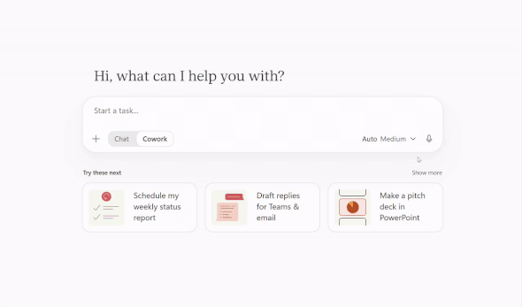
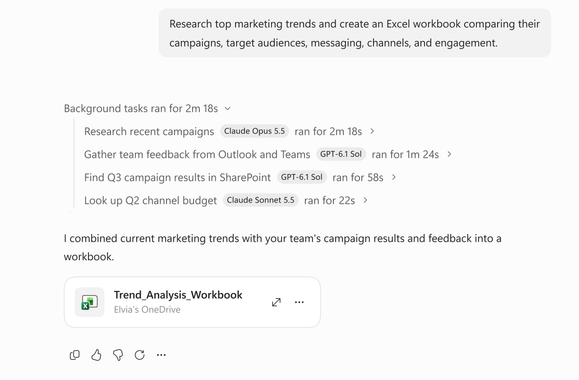
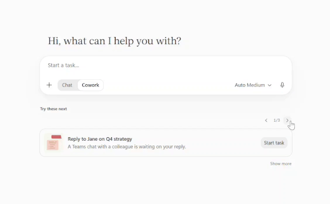
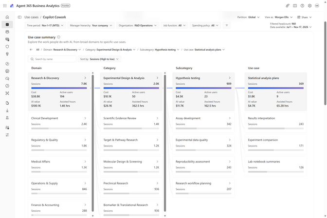

※ この記事は、[What's new in Copilot Cowork at Ignite 2026](https://techcommunity.microsoft.com/blog/microsoft-copilot-blog/whats-new-in-copilot-cowork-at-ignite-2026/4572242) の抄訳です。最新の情報はリンク先をご確認ください。この記事は Microsoft 365 Copilot および GitHub Copilot を使用して抄訳版の作成が行われています。

## Auto の改善、先回りしたタスクの提案、新しいプラグイン、ビジネス価値の分析

Copilot Cowork は仕事の進め方を変えています。営業担当者は、1 四半期分のアカウント活動を事業レビューのプレゼンテーションとフォローアップ計画にまとめます。財務チームは、複数のブックから予測を集め、取締役会に提出できる差異分析メモを作成します。人事・人材育成チームは、数千件のアンケート コメントから対象を絞った学習パスを作成し、法務チームは複数の契約書をプレイブックに照らして確認します。

こうした活用は大規模に広がっています。一般提供を開始してから、Fortune 500 企業の約 80% が Cowork を利用しています。AMD、BlackRock、Blackstone、Chevron、Lilly などの企業で、営業、財務、人事、法務、調査の各チームの仕事が変わりつつあります。また、Cowork は Microsoft Copilot 製品の中でも特に高いユーザー満足度を獲得しており、利用状況は Teams や Outlook のように日常に欠かせないサービスに近づいています。

こうしたお客様が最も評価しているのは、Cowork が単一のモデルにとどまらないことです。複数の主要なモデルを使い、タスクごとに適切なモデルを選びながら、複数の手順を伴う仕事を計画して完了するエージェント型のプラットフォームです。お客様の仕事に根差し、すでに信頼されているガードレールの範囲内で動作します。それが Copilot Cowork の設計の目的であり、Microsoft Ignite 2026 の今週も機能を届け続けています。

## 仕事の各段階に適した最新のフロンティア モデル

Cowork は Copilot のマルチモデル プラットフォーム上で動作するため、最新のフロンティア モデルが利用可能になると、すぐに使えます。この 1 週間だけでも、GPT-6.2 Astra、GPT-6.2 Sol、Claude Fable 5.2 を追加し、Claude Opus と GPT-6.1 Sol モデル向けの Fast mode も追加しました。Fast mode を使うと、速度が重要な場面で、最も難しい作業にも取り組めます。また、タスクごとに推論の強さを自動調整できるよう Auto を改善しました。簡単な情報検索はすばやく行い、複雑な作業ではより深く推論します。バックグラウンドでは、最新の意思決定モデルである **Microsoft-Decision-1.1** が、各ステップで推論の強さを判断するために使われます。より細かく制御したい場合は、いつでも推論の強さを自分で設定できます。仕組みの詳細は、[Command Line のブログ](https://commandline.microsoft.com/microsoft-decision-model-ga/)をご覧ください。

*Auto の推論の強さの調整が有効になった Cowork の入力画面。*

より複雑なタスクでは、Auto は複数のモデルに作業を分け、複数のサブエージェントを並行して実行するようになりました。それぞれのサブエージェントは担当する作業に最適なモデルを使い、最後に結果を 1 つの成果物にまとめます。たとえば競合分析では、競合他社ごとの調査を並行して行い、1 つの概要資料にまとめられます。

*Auto を有効にした Cowork が、タスクに対して複数のサブエージェントを並行して実行しています。*

[Copilot アプリの Home](/blog/home-your-starting-place-for-work-in-the-microsoft-copilot-app/) では、Chat への依頼に回答以上の作業が必要だと Copilot が判断すると、Cowork への引き継ぎを提案します。仕事に必要なタイミングで Cowork を利用できます。Auto のこれらの機能強化は Frontier で本日から利用できます。また、Charles Lamanna による Auto の解説を[最近公開された動画](https://lnkd.in/p/dskKV3Rn)で確認できます。

## 次に委任する仕事を把握する

委任するうえで難しいのは、次に何を任せればよいかを判断することです。Work IQ を活用した**先回りした提案**は、メール、会議、Teams チャットのシグナルを読み取り、翌日の顧客との電話に向けた準備や、返信を待っているスレッドの対応など、Cowork に任せる価値のある次のタスクを提案します。Work IQ は仕事、人間関係、組織を理解しているため、提案には今週、本当に重要なことが反映されます。提案は入力欄のすぐ下に表示されます。1 つ選ぶと Cowork が作業を開始し、優先度の高い事項に先手を打てます。先回りした提案は Frontier で本日から利用できます。

*Cowork の入力欄の下に表示される先回りした提案。提案を選ぶとタスクが始まります。*

## ブランドに沿った成果物や、チームで使い続けられるアプリを作成する

Cowork はすでに、仕事に必要な文書やプレゼンテーションを作成しています。これからは、最初の下書きから自社の成果物らしい見た目に整えられます。現在展開中の **Brand Kit in Cowork** では、「Contoso のブランド キットを使って、第 3 四半期のレビュー資料を作成してください」のように、プロンプトで組織のブランド キットを指定します。Cowork は作成時に色、フォント、ブランドの文体を適用するため、後からデザインを整え直すことなく、最初からブランドに沿ったコンテンツになります。

毎週チームで作り直すトラッカーや、経営陣から繰り返し依頼されるダッシュボードのように、一度限りの成果物で終わらない仕事には、一般提供を開始した **Cowork のアプリ作成機能**を利用できます。必要なものを説明するか、タスクの結果をアプリに変換し、公開して共有すると、チームで使い続けられます。アプリはテナント内の [Copilot Managed Runtime](https://aka.ms/copilotmanagedruntime-ignite-blog) で実行されます。Copilot Managed Runtime も一般提供となり、IT 部門は Microsoft 365 管理センターで各アプリを確認・管理できます。

## ビジネスを支えるシステムをまたいで仕事を進める

仕事で使うのは Microsoft 365 だけではありません。プラグインを使うと、ビジネスに欠かせないシステムを Cowork に接続できます。管理されたデータを扱い、チームがすでに使っているツールで操作を行えるようになります。組織で利用できるプラグインとスキルは管理者が決定します。[新しいプラグイン カタログ](https://aka.ms/CopilotPluginCatalog)を使うと、必要なものを簡単に見つけられます。

Microsoft が開発した新しいプラグインとスキルには、次のものがあります。

- **[Sales プラグイン](https://m365.cloud.microsoft/cowork#/extensions/plugins/P_a76d80a1-a266-3211-bf3f-beec913ccb45)の追加スキル:** 営業担当者がアカウント概要、提案プレゼンテーション、顧客向けの事業レビュー、提案依頼への回答を作成できます。また、Cowork と PowerPoint 内で、任意の CRM や Microsoft 365 のデータを基に、案件、営業パイプライン、会議に関する分析情報を得られます。スキルは 19 種類あります。
- **Planner と Viva Engage のプラグイン (一般提供):** 計画、タスク、コミュニティを Cowork に取り込み、Planner や Viva Engage にある仕事を委任できます。
- **[Workforce Intelligence プラグイン](https://techcommunity.microsoft.com/blog/microsoft-copilot-blog/copilot-that-understands-your-organization-introducing-people-and-org-context-in/4573356) (Frontier):** Work IQ の人や組織のコンテキストを Cowork に取り込みます。リーダーは従業員数、組織階層、管理範囲の全体像を把握し、チームにどのようなスキルがあるかを確認して、リーダーシップ レビュー用の共有可能なダッシュボードを作成できます。

仕事がブラウザー上で行われる場合は、**Cowork in Edge for Business** も対応します。Edge のサイド パネルまたは新しいタブ ページから、Web サイトをまたぐ複数ステップのタスクを完了できます。すでにアクセスできるサイトのみで動作し、サインインや支払い情報の入力時には操作を利用者に戻します。慎重な確認が必要な操作を実行する前に、承認を求めます。詳しくは[Edge for Business の Ignite ブログ](https://aka.ms/EdgeIgnite26)をご覧ください。

## 信頼を保ちながら規模を拡大し、価値を確認する

Cowork がより多くの仕事を担うにつれて、リーダーはその仕事がどのような価値を生み出すかを知りたいと考えています。本日から Frontier への展開を開始する **Agent 365 Business Analytics** は、AI の支出、利用状況、価値を 1 か所にまとめます。Cowork については、タスクを関連するビジネス ユース ケースに対応付け、Cowork が完了を支援した仕事の価値を推定します。正常に完了したタスクごとに、その仕事に通常かかる時間と Cowork の貢献度を組み合わせて、Cowork が支援した時間を算出し、その時間を推定金額に換算します。また、Microsoft 365 管理センターの **Agent 365 Cost Management** により、支出を予測しやすくなります。IT 部門は、ユーザー、エージェント、モデルごとの消費量を確認し、支出の上限やアラートを設定し、チームが使えるモデルを選択できます。これにより、支出が想定外に膨らむのを防げます。詳細は[Agent 365 Business Analytics のブログ](https://techcommunity.microsoft.com/blog/ai-finops-blog/introducing-microsoft-agent-365-business-analytics-turn-ai-investment-into-busin/4574149)をご覧ください。

*Copilot Cowork が完了したタスクによる AI の支出、利用状況、推定ビジネス価値を示す Agent 365 Business Analytics のダッシュボード。*

仕事の進め方を信頼できなければ、その価値を得ることはできません。銀行・資本市場から保険、医療に至るまで、特に規制の厳しい業界のお客様は、すでに Cowork を利用しています。Cowork は組織がすでに使っている Microsoft 365 のセキュリティ、コンプライアンス、ガバナンスの範囲内で動作し、各ユーザーの既存のアクセス許可に従うためです。今回、政府機関のお客様にも対象を広げます。Copilot Cowork in GCC は今月から展開を開始します。これにより、公共部門のチームは、使い慣れた ID とコンプライアンスの制御を維持したまま、政府機関向けクラウドの境界内で仕事を委任できます。

## 利用を始める

Microsoft Ignite では、Copilot Cowork チームがこれらの更新について詳しく紹介するセッション [Beyond Chat: Delegate Complex Work with Copilot Cowork](https://ignite.microsoft.com/en-US/sessions/1787856604099001E2sI-1791588098623001CegD?source=sessions) (BRK 205) に参加できます。また、Cowork の開発方法については、Bas Brekelmans による [Command Line のブログ記事](https://commandline.microsoft.com/how-we-built-copilot-cowork-python-to-rust-migration/)をご覧ください。9 人のエンジニアが 1 日で 1,211 件のプル リクエストをマージしたこと、エージェントを使った開発を支える 6 つの実践、稼働中の Cowork ランタイムを Python から Rust に移行した方法を紹介しています。

Ignite での Copilot の発表については、[Jared Spataro の Ignite ブログ](https://aka.ms/microsoftignite26blog)をご覧ください。

*推論レベルとサブエージェントを使う Auto、先回りした提案、Workforce Intelligence プラグイン、Agent 365 Business Analytics は、本日から Frontier のお客様への展開を開始します。Brand Kit in Cowork、アプリ作成機能、Sales、Planner、Viva Engage の各プラグイン、Cowork in Edge for Business は一般提供されています。Copilot Cowork in GCC は今月から展開を開始します。*
