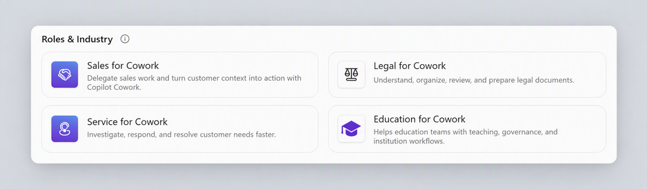
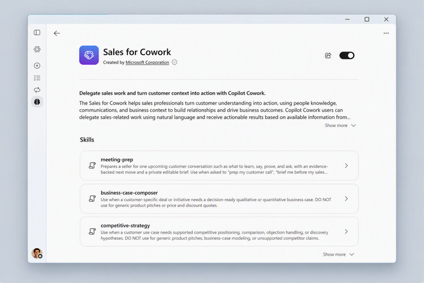
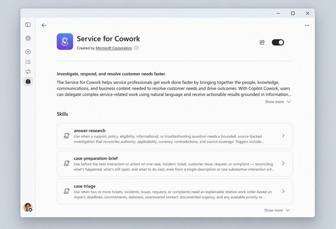
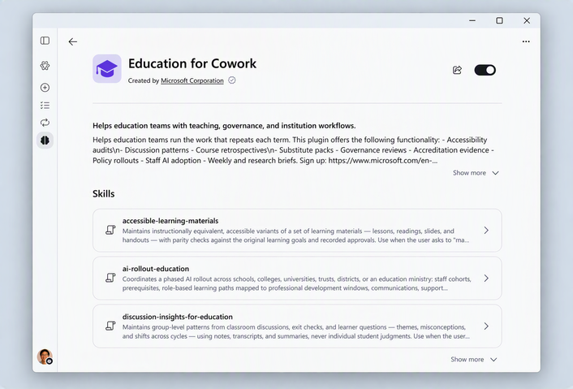
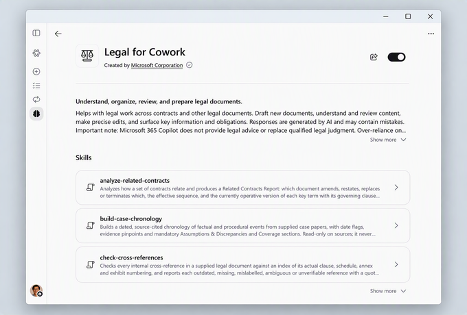

※ この記事は、[What’s New in Cowork: Expanded plugins and role-based skills](https://techcommunity.microsoft.com/blog/microsoft-copilot-blog/what%e2%80%99s-new-in-cowork-expanded-plugins-and-role-based-skills/4566221) の抄訳です。最新の情報はリンク先をご確認ください。この記事は Microsoft 365 Copilot および GitHub Copilot を使用して抄訳版の作成が行われています。

## 営業・サービス・教育・法務向けのスキルと、拡充されたプラグイン ライブラリが登場

今の仕事は、1 つのアプリだけでは完結しません。また、どの役割にも、短いプロンプトだけでは完了しない繰り返しの作業があります。Copilot Cowork (Cowork) は、そうした実情に合わせて作られています。日常的に使うシステムへの接続が広がり、繰り返しのワークフローを取り込んだ役割別スキルが加わることで、アプリ間を行き来したり、毎回同じ指示を伝えたりせずに、仕事を進められます。

## Cowork のプラグインを拡充

先月、Microsoft Copilot の各機能で使うプラグインをまとめて見つけ、管理できる場所として、[プラグイン レジストリ](https://techcommunity.microsoft.com/category/microsoft-copilot/blog/microsoft-copilot-blog)を紹介しました。すでに Cowork でプラグインを使っている場合、使い方は変わりません。これまでと同じように、見つけて有効にし、利用できます。変わるのは、選べる範囲の広さです。Cowork では、次のような、より多くのプラグイン、スキル、コネクタを利用できるようになります。

- **Power Platform コネクタ**: 組織が Power Platform を通じてすでに接続している業務アプリやサービスを、Cowork でも利用できます。Power Platform コネクタは今後数週間にわたって展開されます。[Power Platform コネクタの全一覧はこちら](https://learn.microsoft.com/connectors/connector-reference/connector-reference-powerautomate-connectors)をご覧ください。
- **フェデレーション Copilot コネクタ**: Model Context Protocol (MCP) を使い、外部システムで自分に付与されているアクセス許可の範囲で、そのシステムのライブ データを Cowork に取り込みます。詳細は、[フェデレーション コネクタの概要](https://learn.microsoft.com/microsoft-365/copilot/connectors/federated-connectors-overview)をご覧ください。
- **役割別プラグイン**: チームが日々行うワークフローに特化した、営業・サービス・教育・法務向けのスキルを Cowork に取り込みます。プラグイン ライブラリの新しい Roles & Industry セクションから利用できます。[Cowork の役割別プラグインの詳細はこちら](https://learn.microsoft.com/microsoft-365/copilot/cowork/cowork-available-plugins#role-based-and-industry-plugins)をご覧ください。

組織内で利用できるプラグインやコネクタは、管理者が決定します。管理者の皆さまは、[Cowork のプラグイン管理](https://learn.microsoft.com/microsoft-365/copilot/cowork/cowork-manage-plugins)をご覧ください。

## 役割別プラグイン

営業担当者、サービス チーム、教育関係者、法務担当者には、毎週繰り返す仕事があります。次の顧客との会議の準備、ケース キューへの対応、新学期に向けたコースの準備、承認済みプレイブックに照らした契約書の確認などです。Cowork の新しい **Sales、Service、Education、Legal プラグイン**は、各チームが頼りにしている業務プロセスをスキルとしてまとめています。そのため、空のプロンプトからではなく、役割に応じた構築済みのワークフローから始められます。これらのプラグインは、本日から Customize ページの新しい Roles & Industry セクションで利用できます。

*Copilot アプリの Roles & Industry プラグイン セクション*

### 営業

顧客との会話には準備を整えて臨み、終わるころには次のステップが動き出している。[Sales プラグイン](https://m365.cloud.microsoft/agents/cowork#/extensions/plugins/P_a76d80a1-a266-3211-bf3f-beec913ccb45)は、顧客企業の調査、会議の準備、購買に関わるメンバーの整理、フォローアップ、次に取り組む商談の判断を支援します。メール、会議、ファイルを根拠として作業し、CRM データの利用は任意です。

*Copilot アプリの Sales for Cowork の説明ページ*

**スキルの例:**

- **会議後のフォローアップ**: 決定事項、約束事項、担当者、日付を整理し、確認用の顧客向けフォローアップ文を作成します。
- **パイプラインの優先順位付け**: 進行中の営業案件を、価値、緊急度、リスク、進展の勢いで順位付けし、次に取り組むべきものの理由を示します。
- **商談の最新状況の把握**: 指定した基準時点以降の商談の変化を、顧客側の動きと記録の更新に分けて示します。
- **競合戦略**: 承認済みの競合情報と、トレードオフの率直な評価に基づき、商談に応じた訴求内容や反論への対応を作成します。
- **ビジネス ケースの作成**: 顧客の裏付け資料から、意思決定に使えるビジネス ケースを作成し、不足する情報を示します。
- **エンゲージメント リスクの把握**: 連絡が途絶えがちになっている、接点が 1 人に限られている、または停滞している商談や顧客企業を示します。

**Cowork で試せるタスク:**

- `/post-meeting-follow-up` 「今日の Northwind との会議の後、メモと以前の約束事項を突き合わせてください。決定事項、担当者、日付を整理し、根拠のある記録の変更を提案して、私が確認するための顧客向けフォローアップ文を作成してください。」
- `/pipeline-prioritizer` 「今週の進行中の営業案件を確認してください。価値、緊急度、リスク、進展の勢い、私が結果を変えられる余地を考慮し、根拠、不明点、次のアクションを添えた、優先順位付きの作業リストを返してください。」
- `/deal-catchup` 「先週以降、進行中の商談で何が変わったかを示してください。顧客側の動きと CRM の管理情報の整理・更新を分け、重要な変更にはそれぞれ情報源を示し、私が確認するための記録更新案を提示してください。」

**利用場所:** `Customize > Roles & Industry library > Sales for Cowork`。Dynamics 365 Sales の利用者は、[Dynamics 365 Sales プラグインを追加](https://learn.microsoft.com/dynamics365/sales/use-copilot-cowork-sales-skills)することもできます。

### サービス

ケースの整理にかける時間を減らし、解決に使う時間を増やします。[Service プラグイン](https://m365.cloud.microsoft/agents/cowork#/extensions/plugins/P_f23959cd-c0b1-e2df-b263-750a8c25c5fd)は、サービス チームによるキューの優先順位付け、次の顧客対応の準備、情報源に裏付けられた回答の調査、返信の下書き、得られた知見の再利用可能なナレッジへの変換を支援します。メール、会議、ファイルを根拠として作業し、CRM データの利用は任意です。

*Copilot アプリの Service for Cowork の説明ページ*

**スキルの例:**

- **ケースの優先順位付け**: 未解決のケースを、期限、顧客への影響、約束事項、未返信の連絡に基づいて並べ、判断の理由を示します。
- **ケース対応の準備用概要**: 次の対応に備え、1 件のケースの状況、時系列、試した修正、未完了の約束事項を要約します。
- **回答の調査**: サポートやポリシーに関する質問に対し、情報源に裏付けられた回答を調査し、矛盾する根拠や不十分な根拠を示します。
- **顧客向け返信の下書き**: 検証済みの事実と適用されるポリシーから顧客向け返信を作成し、送信前の確認に回します。
- **ナレッジの抽出**: 検証済みの解決策や回避策を、顧客を特定できる情報を含めずに、ガイダンスの下書きにまとめます。

**Cowork で試せるタスク:**

- `/case-triage` 「未解決のエスカレーションを確認し、優先順位付きの作業リストを作成してください。期限、顧客への影響、以前の約束事項、未返信のメッセージを考慮し、その順序の根拠と不明点を示してください。」
- `/draft-customer-reply` 「顧客の質問、検証済みのケースの事実、適用されるポリシーを使って、私が確認するための返信を作成してください。確認済みの結果と提案段階の対処方法を分け、ポリシーを引用し、送信前に私が確認すべき点を示してください。」
- `/knowledge-harvest` 「このケースの検証済みの解決策を使って、再利用できるガイダンスを作成してください。症状、原因、回避策、テスト済みの修正を分け、顧客を特定できる情報を取り除き、既存の記事との重複を確認してください。」

**利用場所:** `Customize > Roles & Industry library > Service for Cowork`。Dynamics 365 Customer Service の利用者は、[Dynamics 365 Customer Service プラグインを追加](https://learn.microsoft.com/dynamics365/customer-service/use/use-copilot-cowork-service-skills)することもできます。

> **Dynamics 365 を利用している場合**
>
> 先週、[Dynamics 365 Sales、Customer Service、Customer Insights 向けに、Cowork の新しい CRM スキル 30 種類](https://www.microsoft.com/en-us/dynamics-365/blog/it-professional/2026/10/08/bring-microsoft-dynamics-365-into-the-flow-of-work-with-30-new-crm-skills/)を紹介しました。

### 教育

教育機関のリーダーが、最優先の仕事に取り組む時間を確保できるようにします。[Education プラグイン](https://m365.cloud.microsoft/agents/cowork#/extensions/plugins/P_f8ebe6ff-576d-a4b1-4589-9ae613d4b53e)は、認証評価の根拠資料の収集、学習のアクセシビリティ向上、授業の継続性の維持、学習者からのフィードバックの傾向の把握、責任ある AI ガバナンスなど、教育機関の運営を支える定期的な作業を、リーダーや教育者がよりすばやく進められるよう支援します。その分、学生や戦略に使う時間を増やせます。詳細は、[Education ブログ](http://aka.ms/EducationCowork)をご覧ください。

*Copilot アプリの Education for Cowork の説明ページ*

**スキルの例:**

- **認証評価・レビュー向けの根拠資料の作成**: 認証評価やレビューの要件と根拠資料を対応付け、裏付けが弱い、古い、または不足している箇所を示します。
- **ガバナンス レビュー**: 次のステップを提案する前に、AI ツールの技術、データ、セキュリティ、アクセシビリティ、ポリシー、サポートに関する根拠資料を確認します。
- **教育向け AI 展開**: 教育機関内の役割、ガバナンス要件、前提条件、学年暦にわたって、段階的な AI 導入を計画します。
- **ディスカッションのインサイト**: 個人を特定する情報を除いた学習上の議論、フィードバック、質問から、グループ全体の傾向を特定します。
- **アクセシブルな学習教材**: コースや学習教材のアクセシビリティを点検し、学習目標を維持したまま改訂版を作成します。
- **授業の継続性**: 計画、スケジュール、手順、教材を含む、情報源を確認済みの継続対応用資料一式を作成します。

**Cowork で試せるタスク:**

- `/evidence-package-for-education` 「認証評価の要件と、利用できる教育機関の根拠資料を対応付けてください。根拠資料の索引を作成し、要件をどこまで裏付けられるかを評価して、古い裏付けや不足を示し、レビュー チーム向けに優先順位付きの不足項目リストを作成してください。」
- `/accessible-learning-materials` 「これらのコース教材のアクセシビリティと、学習者にとっての使いやすさを確認してください。構造、読み上げ順序、リンク テキスト、画像の説明、字幕、文書内の移動を確認し、優先順位付きの問題リストと確認用の修正案を提示してください。」
- `/instructional-continuity` 「次学期のプログラム向けに、継続対応用の資料一式を作成してください。現在のカリキュラム、過去の計画、学年暦の節目、教育機関のガイダンスを集め、準備状況チェックリスト、リソース一覧、重要な日付、第 1 段階の計画を作成してください。まだ必要な意思決定も示してください。」

**利用場所:** `Customize > Roles & Industry library > Education for Cowork`。

### 法務

[Legal プラグイン](https://m365.cloud.microsoft/agents/cowork#/extensions/plugins/P_68fbbabe-767d-1ebc-7e46-8cb7c8b2818d)は、Word でも利用できるものと同じスキルを基に、20 種類の法務スキルを Cowork に取り込みます。Word でレビューや修正を行い、その後は契約書、メール、会議、ファイルを横断して Cowork で案件をさらに進められます。発表の詳細は、[Microsoft Copilot for legal が登場](/blog/introducing-microsoft-copilot-for-legal/)をご覧ください。

*Copilot アプリの Legal for Cowork の説明ページ*

**スキルの例:**

- **契約書のレビュー**: 適用されるプレイブックに照らして契約書を確認し、注意が必要な条項を特定します。
- **修正の要約**: 修正内容、その影響、どちらの当事者に有利かを説明します。
- **法的義務の特定**: 法務文書全体から、義務、重要な日付、期限を抽出します。
- **主要な条項の比較**: 文書間の主要な条項の共通点と相違点を示します。
- **締結準備の確認**: 法務文書への署名に進む前に、対処すべき課題を示します。
- **案件の時系列の作成**: 案件資料から、主要な出来事、日付、事実を時系列に整理します。

**Cowork で試せるタスク:**

- `/compare-key-terms` 「これらの契約書から主要な条項を抽出・比較し、各結果を情報源にリンクした Excel の契約ポートフォリオ管理表を作成してください。重要な相違点と、私の確認が必要な点を示してください。重要な論点を私が確認したら、取引チーム向けに注意事項の概要を作成してください。」
- `/create-playbook` 「これらの先例から NDA のプレイブックを作成し、標準的な立場、受け入れ可能な代替案、拒否した立場をまとめてください。不整合や不足を、私が確認できるように示してください。提案された立場を私が承認したら、プレイブックを更新し、上位の弁護士への承認依頼を作成してください。」

**利用場所:** `Customize > Roles & Industry library > Legal for Cowork`。

> **プラグインが表示されない場合**
>
> 管理者が先に利用可能にする必要があるか、アクセスを申請する必要がある場合があります。
>
> 各プラグインのスキルの全一覧は、[Cowork で利用できるプラグイン](https://learn.microsoft.com/microsoft-365/copilot/cowork/cowork-available-plugins#role-based-and-industry-plugins)をご覧ください。

### タスク カタログで簡単に始める

どこから始めればよいか迷ったときは、タスク カタログを利用できます。現在 Cowork で展開中の更新されたタスク カタログには、カスタマー サービス、経営層、財務、マーケティング、営業向けのタスク例が含まれます。顧客との会議の準備、ケース キューの優先順位付け、クローズ状況の要約など、どれも実務を始めるためのきっかけになります。タスクを選んで詳細を入力すれば、その後は Cowork が進めます。カタログのタスクと対応するスキルを組み合わせることで、さらによい結果を得られます。

**利用場所:** Cowork を開き、プロンプト ボックスの下にある「Show more」からタスク カタログを参照します。更新されたタスク カタログは、10 月末までに展開されます。

## 普段使っているアプリからタスクを開始

イベント駆動型タスクでは、メールや Teams メッセージの到着をきっかけに、Cowork が作業を始められます。さらに、プラグインと Power Platform コネクタを通じて、新しいケースの作成や商談のステージ変更など、チームが利用するシステム内の変化を監視し、イベントの発生時に作業を開始できるようになります。

監視する内容と開始したいタスクを普段の言葉で説明すると、Cowork が自動化を提案します。カードには、イベント、Cowork が行う内容、必要なアクセス許可が表示されます。内容を確認して承認すれば、それ以降はタスクが自動で実行されます。ほかの自動化と同じように Automations ページに表示され、一時停止、編集、実行履歴の確認を行えます。

**試してみる:**

- 「**[ERP]** で新しい優先度の高いケースが作成されたら、顧客の履歴を含むケースの概要と、私が確認するための最初の返信案を作成してください。」
- 「**[CRM]** の営業案件が Negotiation に移行したら、1 ページの商談概要を作成し、未解決のリスクを示してください。」
- 「**[文書システム]** の法務受付フォルダーに新しい契約書が入ったら、プレイブックに照らして確認し、基準から外れている点の概要を私に送ってください。」

**利用場所:** `Automations > Add > Create with Cowork`。

イベント駆動型タスクでも、主導権は利用者が保持します。タスクは利用者のアクセス許可で動作し、利用者が見られる情報だけを参照します。タスクがメッセージを送信したり、別のシステムの記録を変更したりする場合、Cowork はその操作を準備し、利用者の承認を待ちます。

詳細は、[イベント駆動型タスクの設定](https://learn.microsoft.com/microsoft-365/copilot/cowork/use-cowork#set-up-event-driven-tasks)をご覧ください。対応するトリガーはパートナーが定義しており、各プラグインやコネクタのドキュメントで確認できます。

### 使い始める

Roles & Industry ライブラリを開き、自分の役割に合ったプラグインを追加して、上記のプロンプトを試すか、タスク カタログの候補から始めてください。チームがすでに使っているツールのイベント駆動型トリガーと組み合わせることで、ワークフロー全体を Cowork に委任できます。
