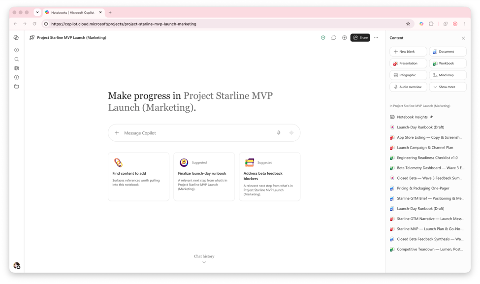
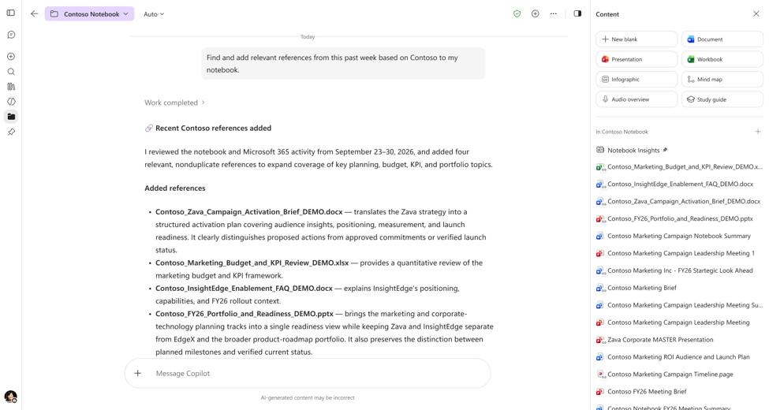
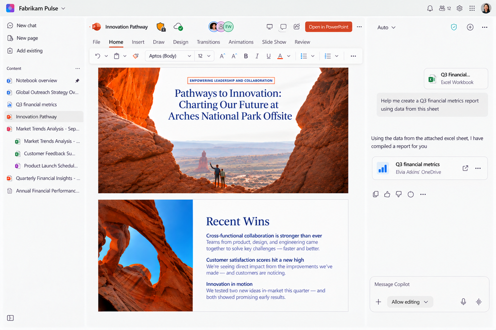
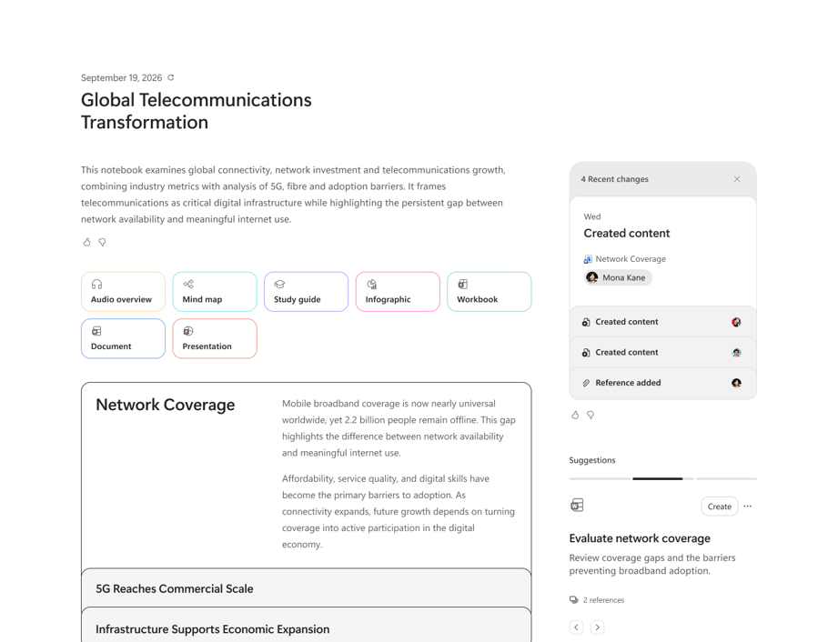

※ この記事は、[What's New in Notebooks | October 2026](https://techcommunity.microsoft.com/blog/microsoft-copilot-blog/whats-new-in-notebooks--october-2026/4559105) の抄訳です。最新の情報はリンク先をご確認ください。この記事は Microsoft 365 Copilot および GitHub Copilot を使用して抄訳版の作成が行われています。

## 簡単な作業の Copilot への委任、Office の豊富な機能を使った Word、Excel、PowerPoint ファイルの直接編集、対話型レポートの作成など、Copilot Notebooks が進化

Copilot Notebooks は、個人やチームが仕事を前に進めるための、プロジェクトやトピックごとの AI ワークスペースです。Microsoft 365 内の業務の背景情報を 1 つのワークスペースにまとめ、参照資料の収集、プロジェクトのコンテキストに基づく質問、業務全体からの重要なインサイトの発見、共有可能な成果物の作成を行えます。今後数週間のうちに [Frontier](https://www.microsoft.com/copilot/resources/frontier-program) に登場する今回の更新では、Notebooks を離れることなく、ノートブックの作成、Copilot との作業、成果物の作成や編集を進められます。[https://aka.ms/copilotnotebooks](https://aka.ms/copilotnotebooks) から Copilot Notebooks を試してみてください。

## ノートブックを簡単に作成

Copilot に依頼して、新しい Copilot Notebook を作成するところから始められます。参照資料として扱える種類が増え、ノートブックを整理しやすい UX に刷新されたことで、自分のワークフローに合ったノートブックを準備できます。

手動で設定する代わりに、目標を Copilot に伝えるだけで新しいノートブックを作成できます。たとえば、「[業界] の新規顧客への提案に取り組んでおり、その業界と主要企業について詳しく知りたいです」と、作りたいノートブックを説明します。**Copilot によるノートブック作成**では、業務データや Web から関連する参照資料を集めて、ノートブックを構成できます。

こうして作成したノートブックは、空の入れ物ではなく、関連する参照資料があらかじめそろったワークスペースになります。**対応する参照資料の種類が増えた**ことで、従来の対応形式に加えて [Markdown、TXT、RTF ファイル](https://techcommunity.microsoft.com/blog/microsoft365copilotblog/copilot-notebooks-now-works-with-markdown-plain-text-and-rich-text-files/4545652) も追加できます。文書、メール、会議に加え、ドキュメント、メモ、ログ、トランスクリプトも含められます。

プロジェクトの進行に合わせて、**新しい UX** が Microsoft Copilot アプリと OneNote での使い勝手を改善します。ナビゲーション ウィンドウからコンテンツや成果物をグループ化したり、並べ替えたりして、ノートブックを整理し、使いやすい状態に保てます。

新しい UX は現在 Frontier で利用でき、Copilot によるノートブック作成は今後数週間のうちに登場する予定です。参照資料の対応形式の拡充は、一般提供されています。

**試してみる:**

- 「[業界] の新規顧客への提案に取り組んでおり、その業界と主要企業について詳しく知りたいです。競合分析と概要を含めて、2026 年のこの業界についてのノートブックを作成してください。」

## Notebooks で Copilot と作業

必要なコンテキストをノートブックにそろえると、Copilot がプロジェクト情報の管理、簡単なタスクの実行、定期的な作業の自動化を通じて、仕事を前に進める手助けをします。Copilot が使用するモデルを選び、必要に応じた応答を得ることもできます。

Copilot は、タスクの実行も支援するようになりました。**簡単な作業を Copilot に任せられます。** 参照資料の管理やノートブックの最新状態の維持、プロジェクトのコンテキスト全体にわたる情報の整理・統合、チャットからの Word、Excel、PowerPoint などの個別ファイルの作成・編集に Copilot を利用できます。プロンプトの対象をノートブック内だけに絞ったり、参照資料の範囲を超えたコンテキストを使うために「Work and web」に切り替えたりすることもできます。

頻繁に行うタスクで、同じプロンプトを何度も入力する必要はありません。毎朝のブリーフィングや週次報告用スライドの作成など、繰り返し行う Copilot のタスクを**簡単な自動化**としてスケジュールすれば、プロンプトは一度伝えるだけで済みます。独自の自動化の新規作成、スケジュールされたタスクのテンプレートの使用、実行頻度やタスクの指示などの設定変更、有効・無効な自動化の確認を行えます。

求める応答の品質に合わせて、**モデルの選択**では、Notebooks のチャットでプロンプトに使用するモデルを指定できます。「より深く考える」ことを求めたり、特定の GPT モデルを選んだりできます。今後、さらに多くのモデルが登場する予定です。

簡単な作業の委任とモデルの選択は、現在 Frontier で利用できます。簡単なタスクの自動化は、今後数週間のうちに登場する予定です。

**試してみる:**

- 「[プロジェクト X] に基づいて、過去 1 週間の関連する参照資料を見つけ、ノートブックに追加してください。」
- 「毎週金曜日の午後 4 時に、[期間] 中の [トピックまたは業務領域] に関する活動を要約してください。主な更新、決定事項、アクション、リスク、未解決の課題を含めてください。1 週間の流れが明確に伝わり、何が変わったかを示し、最後に翌週のフォローアップをまとめた、簡潔な PowerPoint プレゼンテーションを作成してください。」

## Notebooks から成果物を作成・編集

成果物の作成、編集、カスタマイズの方法が増えたことで、Notebooks を離れずにワークフローを完結させ、より多くの作業を進められます。

Notebooks でできることは、参照資料の追加や Copilot とのやり取りだけではありません。**Office の豊富な機能**を使い、作業の流れを中断せずに、文書、スプレッドシート、プレゼンテーションを作成・編集し、共同作業を行えます。文書をインラインで表示し、Word、Excel、PowerPoint ファイルをキャンバス上で直接編集できます。Copilot への指示によって、導入段落、箇条書き、グラフといった新しいコンテンツを追加したり、フォント、色、レイアウトなどの書式を調整したりすることもできます。チームでは、ほかのメンバーを共同作業に招待し、Copilot とともに同じファイルを引き続き改善できます。Office in Copilot の詳細は、[こちら](/blog/introducing-office-in-the-new-microsoft-copilot-app/)をご覧ください。

成果物は、Word、Excel、PowerPoint のファイルだけとは限りません。新たに**対話型レポート**に対応し、従来の Office 成果物を超えたものを作成できます。データの傾向、月次の更新情報など、変化する内容を視覚的に伝えるレポートを、チームや Copilot とともに作成し、その場で編集・共同作業できます。また、チャットを通じてノートブックのコンテンツから **PDF を作成**し、保存や送信に使える、体裁の整った 1 ページの資料などに仕上げることもできます。

視覚的・対話的な成果物に加えて、**更新された音声概要**でも、ノートブックのコンテンツを活用できます。Outlook のメール、Teams の会議やチャット、OneNote や Loop のページ、プレーン テキスト (.txt) ファイルなど、ノートブック内のより多くの種類の参照資料を基に、より包括的な概要を作成できるようになります。「Critique and Debate」などの新しい音声形式も利用できます。長い概要はトピック別のエピソードでたどることができ、音声概要のファイルは秘密度ラベルを引き継いで OneDrive に保存できます。

Copilot は、プロジェクトに適した**成果物を提案**することもできます。Work IQ とノートブックのコンテンツに基づいて、関連する Word、Excel、PowerPoint ファイルを先回りして提案し、すばやく生成できるようにします。今後、さらに多くの種類の成果物に対応する予定です。

Office の機能、対話型レポート、PDF ファイルは、現在 Frontier で利用できます。音声概要の新しい更新は、今後数週間のうちに登場する予定です。成果物の提案は、一般提供されています。

**試してみる:**

- 「このプロジェクト計画に要約、アクション項目、次のステップを追加し、経営層に提示できる文書に更新してください。」
- 「このノートブックから、エグゼクティブ サマリー、視覚的なインサイト、フィルター、詳細を掘り下げられるセクション、情報源に基づく参照資料を備えた、充実した対話型レポートを作成してください。関係者が重要な結果をすばやく把握し、行動に移せるようにしてください。」
- 「このノートブックの重要な結果、決定事項、提言をまとめ、経営層と共有するための 1 ページの PDF エグゼクティブ サマリーを作成してください。」

#### Copilot Notebooks の以前の記事もご覧ください

[Notebooks の新機能 | 2026 年 6 月](https://techcommunity.microsoft.com/blog/microsoft365copilotblog/what%E2%80%99s-new-in-notebooks--june-2026/4525625)
